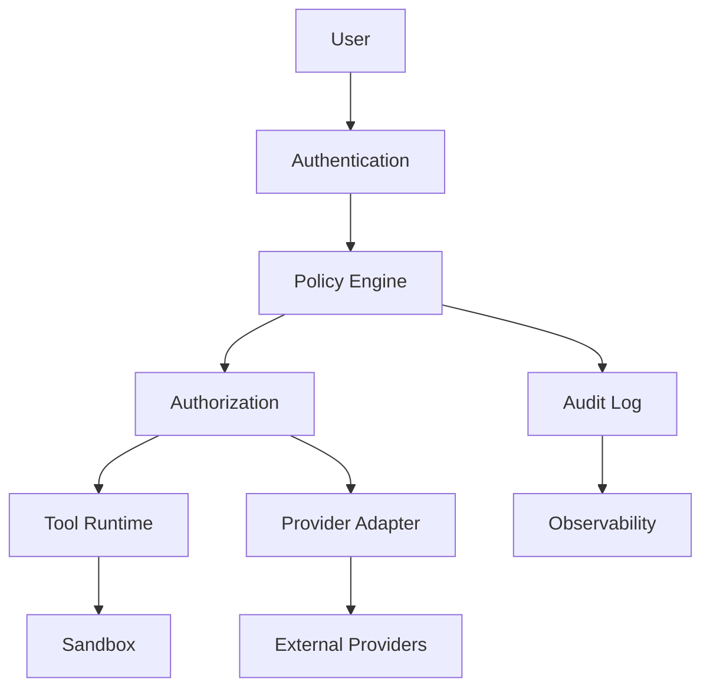

# Security Architecture

## Executive Summary

The Security Architecture establishes the trust model, security controls, and defensive mechanisms for Hermes AIOS. It protects users, data, workflows, plugins, and external integrations while preserving the platform's local-first philosophy and modular architecture.

Security is implemented as a cross-cutting concern that integrates with every subsystem rather than existing as a standalone feature.

---

# Objectives

The Security Architecture is responsible for:

- Authentication
- Authorization
- Secret management
- Encryption
- Plugin security
- Runtime isolation
- Supply-chain protection
- Audit logging
- Threat detection
- Secure updates

---

# Security Principles

Hermes AIOS follows these principles:

- Least privilege
- Default deny
- Defense in depth
- Zero implicit trust
- Secure by default
- Local-first privacy
- Configuration-driven security
- Complete auditability

---

# Trust Zones

```
┌──────────────────────────────┐
│ Zone 1                       │
│ User Interface               │
└──────────────┬───────────────┘
               │
┌──────────────▼───────────────┐
│ Zone 2                       │
│ Hermes Core                  │
│ Kernel                       │
│ Planner                      │
│ Policy Engine                │
└──────────────┬───────────────┘
               │
┌──────────────▼───────────────┐
│ Zone 3                       │
│ Plugins & Tool Runtime       │
└──────────────┬───────────────┘
               │
┌──────────────▼───────────────┐
│ Zone 4                       │
│ External Providers           │
└──────────────────────────────┘
```

Communication across zones is validated and logged.

---

# Authentication

Supported methods:

- Local user accounts
- API keys
- OAuth 2.0 (future)
- Device tokens
- Session tokens
- Service credentials

Authentication providers are replaceable through stable interfaces.

---

# Authorization

Authorization decisions are enforced by the Policy Engine.

Supported models:

- Role-Based Access Control (RBAC)
- Capability-based permissions
- Resource-level permissions
- Operation-level permissions

Examples:

- Read configuration
- Execute tool
- Access filesystem
- Invoke provider
- Install plugin

---

# Secret Management

Secrets include:

- API keys
- OAuth tokens
- Database credentials
- Encryption keys
- Certificates

Secrets are referenced, not embedded.

Example:

```yaml
providers:
  openrouter:
    api_key: ${OPENROUTER_API_KEY}
```

Preferred sources:

- Environment variables
- OS credential stores
- External secret managers

---

# Encryption

## At Rest

Optional encryption for:

- SQLite database
- Configuration backups
- Object storage
- Checkpoints

## In Transit

Required for:

- External provider communication
- Remote APIs
- Future distributed deployments

TLS 1.2 or newer is recommended.

---

# Runtime Isolation

Tool execution is isolated through:

- Process boundaries
- Filesystem restrictions
- Network policies
- Resource quotas
- Temporary workspaces

Plugins never execute with unrestricted access by default.

---

# Plugin Security

Every plugin undergoes:

- Manifest validation
- Permission review
- Optional signature verification
- Dependency validation
- Integrity checks

Unsigned plugins may be disabled by policy.

---

# Supply-Chain Security

Security controls include:

- Dependency verification
- Checksum validation
- Reproducible builds (future)
- Version pinning
- Trusted repositories

---

# API Security

The API Gateway provides:

- Authentication
- Authorization
- Rate limiting
- Request validation
- Audit logging
- Version enforcement

Internal services are not exposed directly.

---

# Data Protection

Sensitive data categories:

- Credentials
- Personal information
- Workflow history
- Memory contents
- Plugin secrets
- Provider tokens

Handling requirements:

- Minimize exposure
- Log access
- Apply Policy Engine rules
- Redact where appropriate

---

# Audit Logging

Security-relevant events include:

- Login attempts
- Permission denials
- Secret access
- Plugin installation
- Policy violations
- Configuration changes
- Security alerts

Audit logs are append-only and tamper-evident where practical.

---

# Incident Response

Suggested workflow:

1. Detect
2. Contain
3. Investigate
4. Recover
5. Review
6. Improve controls

The Observability subsystem provides telemetry to support investigations.

---

# Threat Mitigation

| Threat | Mitigation |
|---------|------------|
| Unauthorized access | Authentication + RBAC |
| Malicious plugin | Sandboxing + signatures |
| Data leakage | Policy Engine + redaction |
| Provider compromise | Provider abstraction + key rotation |
| Resource exhaustion | Quotas + monitoring |
| Tampering | Integrity checks + audit logs |

---

# Security Monitoring

Metrics include:

- Failed logins
- Permission denials
- Secret access
- Plugin failures
- TLS errors
- Policy violations
- Integrity check failures

Alerts integrate with the Observability subsystem.

---

# Configuration

Example:

```yaml
security:
  enforce_tls: true
  verify_plugin_signatures: true
  sandbox_plugins: true
  enable_audit_log: true
  default_permission: deny
```

---

# Mermaid Diagram



---

# Architecture Decisions

## Default Deny

Access is denied unless explicitly authorized.

## Least Privilege

Components receive only the permissions required for their responsibilities.

## Policy-Centric Enforcement

Authorization is centralized in the Policy Engine to ensure consistent decisions across the platform.

## Local-First Privacy

Sensitive data remains local whenever practical, with external transmission governed by explicit policy.

## Defense in Depth

Multiple independent security controls reduce reliance on any single mechanism.

---

# Future Enhancements

- Hardware-backed key storage
- Multi-factor authentication
- Attribute-Based Access Control (ABAC)
- Security policy bundles
- Remote attestation
- Software Bill of Materials (SBOM)
- Vulnerability scanning
- Compliance profiles (e.g., GDPR, HIPAA)

---

# Cross References

Previous:

- `04_3_NETWORKING_ARCHITECTURE.md`

Next:

- `04_5_BACKUP_AND_RECOVERY.md`
