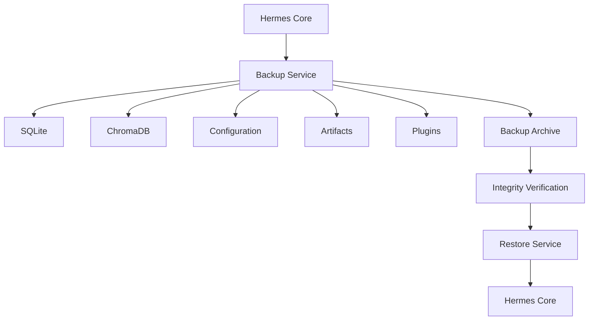

# Backup and Recovery

## Executive Summary

This document defines the backup, restore, and disaster recovery strategy for Hermes AIOS. It ensures that configuration, memory, workflow state, databases, plugins, and user-generated artifacts can be restored with minimal data loss and downtime.

The strategy emphasizes local-first operation while remaining compatible with future remote and distributed deployments.

---

# Objectives

The Backup and Recovery subsystem is responsible for:

- Scheduled backups
- Incremental snapshots
- Point-in-time recovery
- Integrity verification
- Disaster recovery
- Workflow checkpoint restoration
- Configuration rollback
- Backup encryption
- Retention management
- Recovery testing

---

# Design Principles

- Local-first backups
- Immutable backup artifacts
- Automated verification
- Configuration-driven policies
- Minimal Recovery Point Objective (RPO)
- Predictable Recovery Time Objective (RTO)
- Storage independence
- Auditability

---

# Backup Scope

The following data is included in backups:

## Structured Data

- SQLite database
- Scheduler state
- Plugin registry
- Workflow metadata
- User preferences

---

## Vector Data

- ChromaDB collections
- Embedding indexes
- Metadata

---

## Configuration

- YAML configuration
- Environment templates
- Feature flags
- Policy definitions

Secrets remain external to backups unless explicitly configured.

---

## Workflow State

- Active checkpoints
- Paused workflows
- Execution history
- Queue metadata

---

## Artifacts

- Generated reports
- Uploaded files
- Images
- Documents
- Exports

---

## Plugins

- Installed plugins
- Plugin manifests
- Plugin configuration

---

# Backup Types

## Full Backup

Contains:

- Complete databases
- All artifacts
- Configuration
- Plugins

Recommended cadence:

- Weekly

---

## Incremental Backup

Contains:

- Changed files
- Database deltas
- Updated artifacts
- New checkpoints

Recommended cadence:

- Daily or more frequently

---

## Snapshot

Captures the current runtime state:

- Memory checkpoint
- Active workflows
- Scheduler
- Runtime metadata

Useful before upgrades or migrations.

---

# Backup Storage Layout

```
backups/

├── full/
│   ├── 2026-07-01/
│   └── 2026-07-08/
│
├── incremental/
│   ├── 2026-07-07/
│   └── 2026-07-08/
│
├── snapshots/
│
├── manifests/
│
└── checksums/
```

---

# Backup Manifest

Each backup records:

- Backup ID
- Timestamp
- Version
- Backup type
- Included components
- File count
- Checksum
- Compression status
- Encryption status

---

# Recovery Objectives

| Metric | Target |
|--------|--------|
| Recovery Point Objective (RPO) | Configurable |
| Recovery Time Objective (RTO) | Configurable |

Projects with higher availability requirements may choose shorter intervals and additional redundancy.

---

# Recovery Workflow

```
Failure
   │
Detect
   │
Select Backup
   │
Verify Integrity
   │
Restore Data
   │
Restore Configuration
   │
Restore Checkpoints
   │
Validate
   │
Resume Services
```

---

# Restore Order

1. Configuration
2. SQLite
3. ChromaDB
4. Object storage
5. Plugin registry
6. Plugins
7. Workflow checkpoints
8. Scheduler
9. Hermes Core

Dependency-aware restoration prevents inconsistent state.

---

# Checkpoint Recovery

Long-running workflows resume from:

- Stored variables
- Tool outputs
- Memory references
- Event offsets
- Execution status

Checkpoint validation occurs before resumption.

---

# Integrity Verification

Every backup includes:

- SHA-256 checksum
- Manifest validation
- Version verification
- Schema compatibility check

Restores fail safely if integrity validation does not succeed.

---

# Encryption

Optional backup encryption supports:

- AES-256 encrypted archives
- External key management
- Password-protected exports

Encryption keys are never stored with backup data.

---

# Retention Policy

Example policy:

| Backup | Retention |
|--------|-----------|
| Daily incremental | 30 days |
| Weekly full | 12 weeks |
| Monthly archive | 12 months |
| Snapshots | Configurable |

Retention is configurable through the Configuration System.

---

# Disaster Recovery

Recovery priorities:

1. Restore configuration
2. Restore persistent data
3. Resume core services
4. Resume workflows
5. Resume scheduled automations
6. Validate observability

The Event Bus replays pending events where appropriate.

---

# Recovery Testing

Recommended practices:

- Scheduled restore drills
- Integrity verification
- Checksum validation
- Configuration compatibility testing
- Workflow replay testing

Regular testing ensures backups remain usable.

---

# Observability

Metrics include:

- Backup duration
- Backup size
- Restore duration
- Integrity failures
- Backup success rate
- Restore success rate
- Snapshot count

Alerts are generated for failed backups or verification errors.

---

# Mermaid Diagram



---

# Architecture Decisions

## Layered Backup Strategy

Separate backup types balance recovery speed, storage efficiency, and operational simplicity.

## Dependency-Aware Restore

Components are restored in a deterministic order to preserve consistency across the platform.

## Independent Secret Management

Sensitive credentials remain outside backup archives unless explicitly configured otherwise.

## Integrity Before Recovery

Backups are validated before restoration to avoid propagating corruption.

## Recovery Automation

The design supports future automated recovery workflows coordinated through the Event Bus and Workflow Planner.

---

# Future Enhancements

- Continuous data protection
- Cross-device synchronization
- Remote encrypted backup targets
- Incremental block-level backups
- Automatic recovery validation
- Multi-version restore
- Geo-redundant storage
- Backup policy recommendations

---

# Cross References

Previous:

- `04_4_SECURITY_ARCHITECTURE.md`

Next:

- `04_6_MONITORING_AND_OPERATIONS.md`
