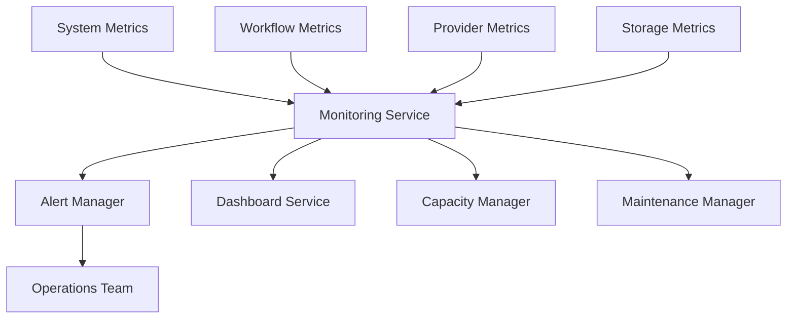

# Monitoring and Operations

## Executive Summary

The Monitoring and Operations architecture defines how Hermes AIOS is operated, monitored, maintained, and supported throughout its lifecycle. It builds upon the Observability subsystem by defining operational procedures, service health management, maintenance workflows, capacity planning, and incident response.

This document focuses on day-to-day operations rather than implementation details.

---

# Objectives

The Monitoring and Operations subsystem is responsible for:

- Continuous health monitoring
- Service lifecycle management
- Alert processing
- Operational dashboards
- Log management
- Capacity planning
- Incident response
- Maintenance scheduling
- Performance tuning
- Operational reporting

---

# Operational Principles

Hermes AIOS operations follow these principles:

- Observe before reacting
- Automate repetitive tasks
- Fail safely
- Minimize downtime
- Preserve user data
- Maintain auditability
- Prefer proactive maintenance
- Keep operations configuration-driven

---

# Operational Components

## Health Manager

Continuously evaluates:

- Hermes Core
- SQLite
- ChromaDB
- Ollama
- Plugin Runtime
- Scheduler
- Event Bus
- Provider Adapter

Health states:

- Healthy
- Degraded
- Unavailable
- Maintenance

---

## Alert Manager

Processes operational alerts.

Alert categories:

- Critical
- High
- Medium
- Low
- Informational

Delivery targets are configurable through the Configuration System.

---

## Log Manager

Collects and manages:

- Application logs
- Audit logs
- Security logs
- Workflow logs
- Plugin logs
- Provider logs

Supports:

- Rotation
- Compression
- Retention
- Archival

---

## Dashboard Service

Operational dashboards include:

- System Overview
- Workflow Activity
- Provider Health
- Storage Usage
- Resource Consumption
- Active Alerts
- Plugin Status
- Scheduler Status

---

## Maintenance Manager

Coordinates:

- Scheduled maintenance
- Database optimization
- Cache cleanup
- Backup verification
- Plugin updates
- Configuration validation

Maintenance windows are configurable.

---

## Capacity Manager

Tracks resource trends:

- CPU
- Memory
- Disk
- GPU
- Database growth
- Vector index size
- Queue depth
- Workflow throughput

Supports proactive scaling decisions.

---

# Health Checks

Every service exposes:

- Liveness endpoint
- Readiness endpoint
- Version information
- Dependency status
- Last successful operation

Example health states:

| Component | Healthy | Degraded | Failed |
|----------|---------|----------|--------|
| Hermes Core | ✓ | ✓ | ✓ |
| SQLite | ✓ | ✓ | ✓ |
| ChromaDB | ✓ | ✓ | ✓ |
| Ollama | ✓ | ✓ | ✓ |
| Scheduler | ✓ | ✓ | ✓ |

---

# Operational Metrics

## System Metrics

- CPU utilization
- Memory usage
- Disk usage
- Network activity
- GPU utilization

---

## Workflow Metrics

- Active workflows
- Completed workflows
- Failed workflows
- Average execution time
- Retry rate

---

## Provider Metrics

- Request latency
- Success rate
- Error rate
- Token usage
- Cost estimates

---

## Storage Metrics

- SQLite size
- ChromaDB size
- Cache size
- Backup growth
- Object storage usage

---

# Alert Lifecycle

```
Metric

↓

Threshold Exceeded

↓

Alert Created

↓

Notification

↓

Investigation

↓

Resolution

↓

Closure

↓

Post-Incident Review
```

---

# Maintenance Schedule

Recommended recurring tasks:

| Task | Frequency |
|------|-----------|
| Backup verification | Daily |
| Database optimization | Weekly |
| Cache cleanup | Daily |
| Log rotation | Daily |
| Plugin updates | Weekly |
| Configuration validation | Weekly |
| Restore testing | Monthly |

---

# Incident Response

Operational workflow:

1. Detect issue
2. Assess severity
3. Contain impact
4. Recover service
5. Validate recovery
6. Conduct post-incident review
7. Implement preventive improvements

Incident timelines are recorded for audit and analysis.

---

# Capacity Planning

Capacity reviews consider:

- Historical growth
- Peak workloads
- Resource utilization
- Provider usage
- Memory expansion
- Storage consumption

Recommendations are generated before resource exhaustion occurs.

---

# Operational Runbooks

Each major subsystem should have a documented runbook including:

- Startup procedure
- Shutdown procedure
- Recovery steps
- Common failure modes
- Diagnostic commands
- Escalation paths

Runbooks are version-controlled alongside the architecture documentation.

---

# Log Retention

Suggested defaults:

| Log Type | Retention |
|----------|-----------|
| Application | 30 days |
| Audit | Configurable |
| Security | Configurable |
| Debug | 7 days |
| Performance | 30 days |

Retention is configurable through the Configuration System.

---

# Operational Security

Operational activities respect the Security Architecture:

- Role-based access
- Audit logging
- Secret isolation
- Configuration validation
- Approval workflows (future)

---

# Mermaid Diagram



---

# Architecture Decisions

## Unified Operations Layer

Operational concerns are centralized rather than embedded in individual components.

## Health-Driven Management

Automated health checks provide early detection of failures and support graceful degradation.

## Metrics Before Alerts

Alerts are derived from monitored metrics, reducing noise and enabling threshold tuning.

## Runbook-First Operations

Every critical component is accompanied by a documented operational procedure.

## Configuration-Driven Policies

Monitoring thresholds, maintenance windows, and retention policies are configurable without code changes.

---

# Future Enhancements

- Predictive failure detection
- Automated remediation
- AI-assisted incident analysis
- Service-level objective (SLO) tracking
- Capacity forecasting
- Distributed operations dashboards
- Multi-node monitoring
- Self-healing workflows

---

# Cross References

Previous:

- `04_5_BACKUP_AND_RECOVERY.md`

Next:

- `04_7_SCALING_STRATEGY.md`
