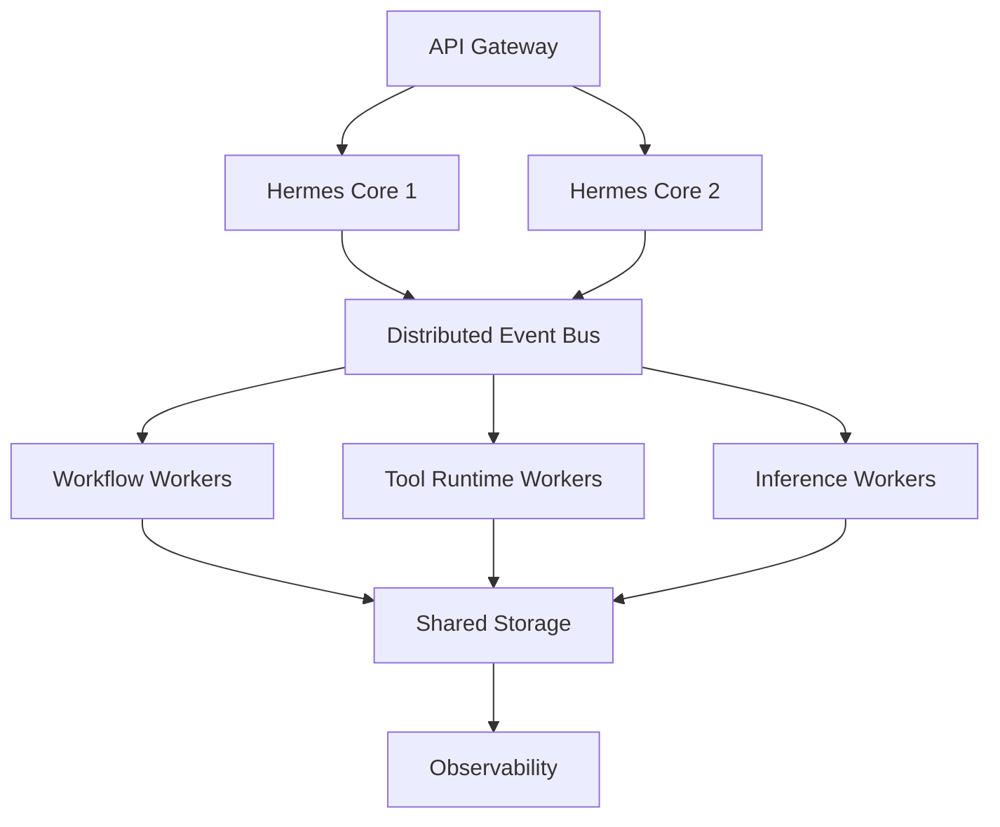

# Scaling Strategy

## Executive Summary

The Scaling Strategy defines how Hermes AIOS evolves from a single-user, local-first deployment into a platform capable of supporting larger workloads, multiple execution nodes, and enterprise-scale deployments. Scaling is achieved through modular expansion while preserving the logical architecture established in previous phases.

The design prioritizes predictable growth, configuration-driven behavior, and incremental adoption.

---

# Objectives

The Scaling Strategy is responsible for:

- Vertical scaling
- Horizontal scaling
- Distributed execution
- Storage scaling
- Provider scaling
- Workflow distribution
- Event bus scalability
- Capacity planning
- Performance optimization
- Future clustering

---

# Design Principles

- Local-first by default
- Scale only when required
- Stateless orchestration
- Stateful persistence
- Loose coupling
- Incremental evolution
- Configuration-driven scaling
- Observable performance

---

# Scaling Stages

## Stage 1 — Local Workstation

Target:

- Single developer
- Single workstation
- Local databases
- Local models
- Optional cloud providers

Characteristics:

- One Hermes Core process
- SQLite
- ChromaDB
- Ollama
- Single Event Bus

---

## Stage 2 — Multi-Service

Separate long-running services:

- Hermes Core
- Scheduler
- Tool Runtime
- Observability
- Plugin Runtime

Benefits:

- Independent upgrades
- Fault isolation
- Better resource utilization

---

## Stage 3 — Distributed Workers

Adds:

- Remote Tool Runtime workers
- Dedicated inference nodes
- Shared event transport
- Shared storage

The Workflow Planner assigns work based on capabilities and resource availability.

---

## Stage 4 — Cluster Deployment

Adds:

- Multiple Hermes Core instances
- Distributed event bus
- Shared databases
- Load balancing
- High availability
- Automatic failover

---

# Vertical Scaling

Increase resources on a single machine:

- CPU cores
- RAM
- Storage
- GPU
- Network bandwidth

Suitable for:

- Personal deployments
- Local inference
- Large embedding collections

---

# Horizontal Scaling

Add additional nodes.

Scalable components:

| Component | Strategy |
|-----------|----------|
| Tool Runtime | Worker pool |
| Provider Adapter | Multiple instances |
| Event Bus | Distributed broker |
| Observability | Central aggregation |
| API Gateway | Load balanced |

Stateful components require coordinated storage.

---

# Workflow Distribution

The Workflow Planner assigns execution based on:

- Capability requirements
- CPU utilization
- GPU availability
- Queue depth
- Estimated execution cost
- Provider latency
- Policy constraints

This preserves the capability-first orchestration model.

---

# Storage Scaling

## Structured Data

Evolution:

SQLite

↓

PostgreSQL (optional)

↓

Clustered relational database (future)

---

## Vector Storage

Evolution:

ChromaDB

↓

Dedicated vector database

↓

Distributed vector cluster

Examples:

- Qdrant
- Milvus
- Weaviate

Adapters preserve a stable Storage Service API.

---

# Event Bus Scaling

Stage 1:

- In-process event bus

Stage 2:

- Local message broker

Stage 3:

- Distributed event transport

Characteristics:

- Durable queues
- Replay support
- Ordered delivery
- Consumer groups

---

# Provider Scaling

Provider Adapter supports:

- Multiple provider instances
- Regional endpoints
- Automatic failover
- Health-aware routing
- Cost-aware selection
- Capability-aware routing

Provider expansion does not affect higher-level components.

---

# Load Balancing

Future deployments may load-balance:

- API Gateway
- Tool Runtime
- Provider Adapter
- Workflow execution

Strategies:

- Round robin
- Least connections
- Capability-aware routing
- Resource-aware routing

---

# Performance Optimization

Key techniques:

- Parallel workflow execution
- Connection pooling
- Embedding cache
- Provider response caching
- Batch processing
- Lazy loading
- Efficient indexing
- Background maintenance

---

# Capacity Planning

Capacity decisions are based on:

- Workflow growth
- Storage growth
- Memory usage
- Token consumption
- Provider utilization
- Queue depth
- User activity

Metrics originate from the Observability subsystem.

---

# High Availability

Future enterprise deployments may include:

- Active/active API gateways
- Replicated databases
- Distributed event transport
- Worker redundancy
- Automatic leader election
- Health-aware failover

Single-user deployments remain intentionally simpler.

---

# Failure Handling

Scaling introduces additional failure scenarios.

Recovery mechanisms include:

- Automatic retries
- Worker reassignment
- Checkpoint restoration
- Event replay
- Provider failover
- Graceful degradation

The Workflow Planner coordinates recovery with the Event Bus.

---

# Mermaid Diagram

---

# Architecture Decisions

## Progressive Scaling

Hermes AIOS begins as a single-process application and expands through well-defined stages without redesigning core components.

## Stateless Orchestration

The Kernel, Capability Router, and Workflow Planner avoid persistent local state where possible, simplifying horizontal scaling.

## Stable Interfaces

Scaling affects deployment topology rather than component contracts, allowing the logical architecture to remain unchanged.

## Capability-Based Scheduling

Execution decisions continue to prioritize required capabilities, with resource availability serving as an additional optimization signal.

## Infrastructure Independence

The architecture supports native processes, containers, and future orchestration platforms without changing application logic.

---

# Future Enhancements

- Kubernetes deployment manifests
- Automatic node discovery
- Multi-region execution
- Cross-site replication
- Autoscaling policies
- GPU scheduling
- Predictive workload balancing
- Federated Hermes deployments

---

# Cross References

Previous:

- `04_6_MONITORING_AND_OPERATIONS.md`

Next:

- `05_IMPLEMENTATION_ROADMAP.md`
