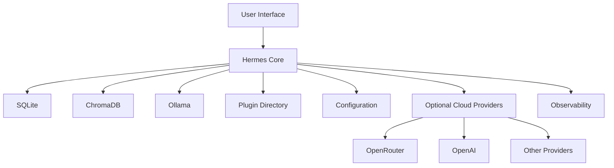

# Infrastructure Overview

## Executive Summary

This document defines the deployment architecture for Hermes AIOS. While the Phase 1 architecture describes logical components and their interactions, this document specifies how those components are deployed, communicate, and operate across development, testing, and production environments.

Hermes AIOS is designed to support:

- Local-first execution
- Hybrid local/cloud AI inference
- Modular deployment
- Configuration-driven infrastructure
- Incremental scalability

---

# Infrastructure Principles

The infrastructure is designed around the following principles:

- Local-first
- Offline capable
- Cloud optional
- Provider independent
- Secure by default
- Observable
- Container-friendly
- Portable across operating systems

---

# Deployment Targets

Hermes supports multiple deployment profiles.

## Development

Purpose:

- Local development
- Debugging
- Documentation
- Testing

Characteristics:

- Single machine
- SQLite
- ChromaDB
- Local Ollama
- Optional cloud providers

---

## Personal Production

Primary deployment model.

Runs on:

- Linux
- Windows (WSL)
- Native desktop

Characteristics:

- Persistent memory
- Background services
- Plugin support
- Scheduled automations
- Hybrid inference

---

## Team Deployment (Future)

Designed for:

- Shared memory
- Multiple users
- Remote execution
- Central observability

---

## Distributed Deployment (Future)

Supports:

- Multiple nodes
- Shared event bus
- Distributed workers
- Remote provider clusters

---

# Runtime Architecture

```
+----------------------------------------------------+
|                  Hermes AIOS                        |
|                                                    |
|  Kernel                                            |
|  Capability Router                                 |
|  Workflow Planner                                  |
|  Policy Engine                                     |
|  Memory System                                     |
|  Tool Runtime                                      |
|  Provider Adapter                                  |
|  Event Bus                                         |
|  Observability                                     |
+----------------------------------------------------+

             │

      Infrastructure Layer

             │

 ┌────────────────────────────────────────────┐
 │ SQLite                                     │
 │ ChromaDB                                   │
 │ Ollama                                     │
 │ Plugin Directory                           │
 │ Configuration Files                        │
 │ Logs                                       │
 └────────────────────────────────────────────┘
```

---

# Process Model

Initial deployment uses a single host.

Recommended long-running processes:

- Hermes Core
- Ollama
- ChromaDB
- Scheduler
- Observability Service

Future releases may separate these into independent services.

---

# Storage Layout

Example directory structure:

```
hermes/

├── config/
├── data/
│   ├── sqlite/
│   ├── chroma/
│   └── cache/
├── logs/
├── plugins/
├── models/
├── workflows/
├── backups/
└── temp/
```

---

# Networking

Default architecture:

```
User
 │
 ▼
Hermes API
 │
 ▼
Internal Services

 ├── Memory
 ├── Tool Runtime
 ├── Provider Adapter
 └── Observability

        │

External Providers (Optional)

- OpenRouter
- OpenAI
- Anthropic
- Others
```

The internal service boundary is isolated from external providers through the Provider Adapter.

---

# Security Boundaries

Infrastructure separates:

- User interface
- Core services
- Storage
- Plugins
- External providers

Communication between layers passes through authenticated interfaces where applicable.

---

# Persistence

Persistent components include:

- SQLite databases
- ChromaDB collections
- Configuration
- Logs
- Plugin metadata
- Workflow history
- Memory artifacts

Temporary execution data is stored separately and cleaned automatically.

---

# Deployment Profiles

| Profile | Components |
|---------|------------|
| Development | Core, SQLite, ChromaDB, Ollama |
| Personal | Development + Scheduler + Backups |
| Team | Personal + Shared Services |
| Distributed | Team + Remote Workers |

---

# Backup Strategy

Recommended backup targets:

- SQLite database
- ChromaDB data
- Configuration
- Plugins
- Workflow definitions

Backup cadence is configurable.

---

# Monitoring

Infrastructure metrics include:

- CPU
- Memory
- Disk
- GPU
- Database size
- Queue depth
- Active workflows
- Provider health

These integrate with the Observability subsystem.

---

# Scalability Roadmap

Phase 1:

- Single process
- Single machine

Phase 2:

- Multiple local services

Phase 3:

- Containerized deployment

Phase 4:

- Multi-node orchestration

---

# Mermaid Diagram



---

# Architecture Decisions

## Local-First

All core functionality operates without mandatory cloud connectivity.

## Modular Services

Infrastructure components may be separated into independent services as scaling requirements increase.

## Storage Isolation

Operational data, memory, configuration, logs, and plugins are stored in dedicated locations to simplify maintenance and backup.

## Provider Independence

External AI services are optional and accessed only through the Provider Adapter.

## Future Containerization

The architecture is compatible with Docker, Podman, and Kubernetes without requiring changes to the logical architecture.

---

# Future Enhancements

- High-availability deployments
- Distributed scheduler
- Remote execution workers
- Shared vector databases
- Enterprise authentication
- Infrastructure-as-Code
- Automatic backups
- Cluster management

---

# Cross References

Previous:

- `03B_11_CONFIGURATION_SYSTEM.md`

Next:

- `04_1_DEPLOYMENT_ARCHITECTURE.md`
