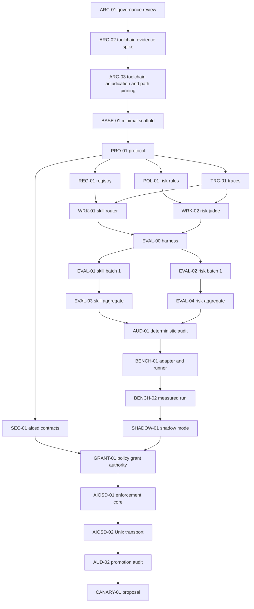

# ZHOOR implementation roadmap

This is a dependency map, not a calendar. A phase advances only when its gate is evidenced in code, tests, review, and handoffs.

## Dependency graph

## Phase 0 — governance and foundation

**Jobs:** `ARC-01`, `ARC-02`, `ARC-03`, `BASE-01`  
**Goal:** validate authority, gather toolchain evidence, accept one stack/layout, pin every downstream path/check, and build the smallest verified skeleton.

**Gate:** owner-accepted ADR; named integration branch; exact format/lint/static-check/test/build commands; mechanically disjoint card paths; clean CI. The sole pre-existing product behavior allowed before this phase is the bounded ADR-0002 `system.info.read` exception; Phase 0 authorizes no additional behavior or capability.

ARC-02 evidence must be independently reviewed and accepted before ARC-03 becomes `READY`. ARC-03 consumes that evidence; it cannot provide ARC-02's missing review.

## Phase 1 — protocol and deterministic foundations

**Jobs:** `PRO-01`, then `REG-01`, `POL-01`, `TRC-01`, `SEC-01` in parallel  
**Goal:** versioned decision/evidence/trace contracts, compact descriptors, non-authoritative risk rules, replayable traces, and separate `aiosd`/grant contracts.

**Gate:** malformed, over-budget, unknown-version, tampered, and hostile fixtures fail closed; no network/model/execution dependency.

## Phase 2 — two-worker vertical slice

**Jobs:** `WRK-01`, `WRK-02`  
**Goal:** deterministic `skill_router` and non-authoritative scoring `risk_judge` behind the shared protocol.

**Gate:** both emit traces, respect budgets, abstain/escalate explicitly, and cannot authorize, deny authoritatively, request, or execute capabilities.

## Phase 3 — evaluation and deterministic audit

**Jobs:** `EVAL-00`; parallel first batches `EVAL-01`/`EVAL-02`; parallel completion batches `EVAL-03`/`EVAL-04`; `AUD-01`  
**Goal:** 50–100 human/deterministically reviewed cases per worker and replay metrics before any semantic backend.

**Gate:** schema validity, correctness, false-choice/false-low-risk, abstention/escalation, latency, provenance, and regression reports pass architecture/security audit.

## Phase 4 — semantic backend benchmark

**Jobs:** `BENCH-01`, then approval-gated `BENCH-02`  
**Goal:** first build a replaceable adapter/runner, then compare deterministic/index baselines with one approved local candidate on frozen cases and target hardware.

**Gate:** reviewed accuracy, abstention, calibration, peak memory, cold/warm load, queue/inference latency, cost/privacy/egress, timeout, and failure behavior. Valid JSON is not semantic correctness.

Needle is not installed before `BENCH-02`; Jev/TypeSafe is not a dependency. Any Needle run requires owner approval, current package/license verification, a disposable environment, telemetry disabled, sanitized data, and no training extras/hosted service.

## Phase 5 — shadow before execution-boundary implementation

**Job:** `SHADOW-01`  
**Goal:** compare deterministic and candidate recommendations with explicit operator labels while changing no production decision or capability.

**Gate:** shadow metrics and disagreements are reviewed; deterministic fallback remains intact; no autonomous effect.

## Phase 6 — policy grant authority and non-mutating aiosd

**Jobs:** `GRANT-01`, `AIOSD-01`, `AIOSD-02` in strict order  
**Goal:** prove policy-owned grant issuance/verification, transport-independent enforcement/immutable receipts, then Unix peer identity and lifecycle for only `capabilities.describe`.

**Gate:** caller/grant/argument/replay/expiry/receipt/socket attacks fail closed; no mutation, privilege, shell, service, package, filesystem write, or network capability exists.

## Phase 7 — promotion audit and canary proposal

**Jobs:** `AUD-02`, then `CANARY-01`  
**Goal:** decide whether evidence permits proposing exactly one reversible low-risk capability. No implementation is pre-authorized.

**Gate:** human owner accepts a new ADR; otherwise stop with no canary.

## Session design

- One card is one bounded logical work unit, normally one context window and one logical commit.
- An interrupted card may resume in a new session using the same handoff and attempt count; it never absorbs a second card.
- Implementation cards touch one subsystem plus owned tests/fixtures/docs.
- Reviews are separate and use unique review handoffs; reviewers do not edit implementation.
- If scope grows, create a successor card rather than silently continuing.

## Global release gates

A dependent card stays blocked until:

1. card-specific exact validation commands pass;
2. implementation and independent review handoffs exist;
3. no out-of-scope files changed;
4. architecture/security invariants remain intact;
5. blocking findings are resolved;
6. the orchestrator alone changes board status.

## First useful release

A local CLI/library/API accepts versioned requests for `skill_router` and `risk_judge`, resolves deterministic/index cases, emits sanitized replayable traces, reports explicit abstention/escalation/error states, and ships reviewed evaluation datasets. It performs no autonomous OS action and requires no LLM.
