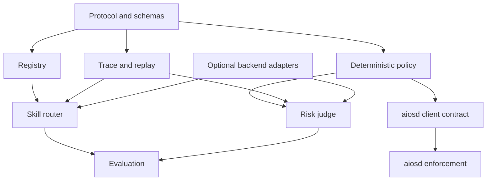

# Target repository scaffold

This is the intended shape after the corresponding jobs complete. It is **not** permission for one agent to create the whole tree. Each card creates only its owned slice.

```text
ZHOOR-AIOS/
├── docs/
│   ├── architecture/
│   │   ├── ZHOOR_ARCHITECTURE-v0.2.md
│   │   └── adr/
│   ├── planning/zhoor-adoption/
│   ├── contracts/
│   ├── evaluations/
│   └── legacy/                      # optional later disposition, not required now
├── schemas/
│   ├── protocol/                    # PRO-01: request/response/evidence wire schemas
│   ├── registry/                    # REG-01 registry descriptor schemas
│   ├── risk-policy/                 # POL-01 policy input/output schemas
│   ├── trace/                       # TRC-01 trace wire schema
│   └── aiosd/                       # SEC-01 only
├── fixtures/
│   ├── protocol/{valid,invalid}/
│   ├── skill-router/
│   ├── risk-judge/
│   └── aiosd/
├── src/                             # thin root CLI only; no domain rules
│   └── main.rs
├── crates/                          # one Rust package per deterministic component
│   ├── protocol/                    # PRO-01
│   ├── registry/                    # REG-01
│   ├── risk-policy/                 # POL-01
│   ├── trace/                       # TRC-01
│   ├── aiosd-contracts/             # SEC-01 contracts only
│   ├── skill-router/                # WRK-01
│   ├── risk-judge/                  # WRK-02
│   ├── backend-adapter/             # BENCH-01, after AUD-01
│   ├── shadow/                      # SHADOW-01
│   ├── grant/                       # GRANT-01
│   ├── aiosd-core/                  # AIOSD-01
│   └── aiosd-unix/                  # AIOSD-02
├── tools/eval/                      # offline Python stdlib tooling only
├── eval/
│   ├── datasets/
│   ├── reports/
│   └── benchmarks/
├── tests/                           # root CLI smoke only
├── scripts/                         # only repeatable development commands
├── .github/workflows/
├── README.md
├── Cargo.toml / Cargo.lock / rust-toolchain.toml
└── toolchain policy proposed by ARC-03 in ADR-0003
```

## Required dependency direction



- Protocol has no dependency on workers, providers, memory, or execution.
- Registry and policy deterministic paths have no model dependency.
- Workers depend on abstractions, not concrete inference providers.
- Trace serialization must not import worker implementation internals.
- `aiosd` must not import semantic workers or decide what action is desirable.
- Evaluation may depend on public interfaces but production modules must not depend on datasets/reports.

## Initial public surfaces

- Validate a versioned decision request/response.
- List/validate compact skill descriptors.
- Resolve deterministic `skill_router` requests.
- Resolve deterministic `risk_judge` requests.
- Emit and replay sanitized traces.
- Run offline evaluation.

No initial public surface executes OS capabilities.

## Toolchain gate

`ARC-02` gathered reproducible toolchain evidence only; it did not choose a production language or package layout. ARC-03 proposes the root CLI plus Rust workspace crates shown above, language-neutral schemas under `schemas/`, and Python only for offline development tooling. This illustrative scaffold follows proposed ADR-0003, which remains pending owner acceptance. Do not scaffold both production runtimes.
