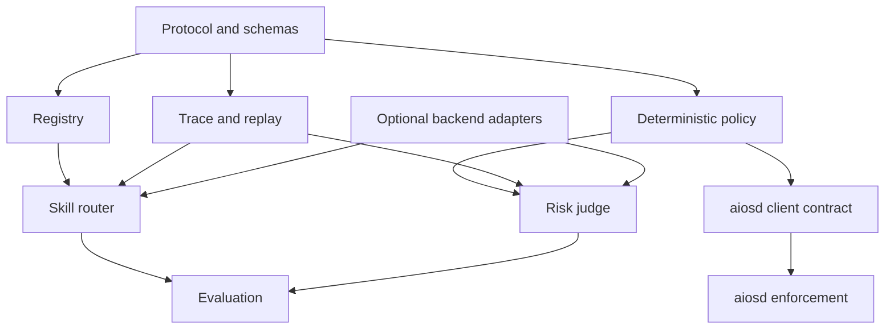

# Target repository scaffold

This is the intended shape after the corresponding jobs complete. It is **not** permission for one agent to create the whole tree. Each card creates only its owned slice.

```text
ZHOOR-AIOS/
├── docs/
│   ├── architecture/
│   │   ├── ZHOOR_ARCHITECTURE-v0.2.md
│   │   └── adr/
│   ├── planning/zhoor-adoption/
│   ├── contracts/
│   ├── evaluations/
│   └── legacy/                      # optional later disposition, not required now
├── schemas/
│   ├── decision-request.v1.json
│   ├── decision-response.v1.json
│   ├── evidence-ref.v1.json
│   ├── trace.v1.json
│   └── aiosd/                       # SEC-01 only
├── fixtures/
│   ├── protocol/{valid,invalid}/
│   ├── skill-router/
│   ├── risk-judge/
│   └── aiosd/
├── src/                             # exact package/crate shape chosen by ARC-02
│   ├── protocol/
│   ├── registry/
│   ├── policy/
│   ├── trace/
│   ├── workers/
│   │   ├── skill_router/
│   │   └── risk_judge/
│   ├── backends/                    # created only in BENCH-01
│   └── aiosd/                       # created only in AIOSD-01
├── eval/
│   ├── harness/
│   ├── datasets/
│   └── reports/
├── tests/
├── scripts/                         # only repeatable development commands
├── .github/workflows/
├── README.md
└── toolchain manifests chosen by ARC-02
```

## Required dependency direction



- Protocol has no dependency on workers, providers, memory, or execution.
- Registry and policy deterministic paths have no model dependency.
- Workers depend on abstractions, not concrete inference providers.
- Trace serialization must not import worker implementation internals.
- `aiosd` must not import semantic workers or decide what action is desirable.
- Evaluation may depend on public interfaces but production modules must not depend on datasets/reports.

## Initial public surfaces

- Validate a versioned decision request/response.
- List/validate compact skill descriptors.
- Resolve deterministic `skill_router` requests.
- Resolve deterministic `risk_judge` requests.
- Emit and replay sanitized traces.
- Run offline evaluation.

No initial public surface executes OS capabilities.

## Toolchain gate

`ARC-02` gathers reproducible toolchain evidence; `ARC-03` must choose the implementation language and exact layout, then pin card paths and validation commands. Rust is a strong candidate for the runtime/enforcement boundary; Python is useful for evaluation and rapid fixtures. The decision must minimize duplicate domain logic. Do not scaffold both production runtimes by default.
