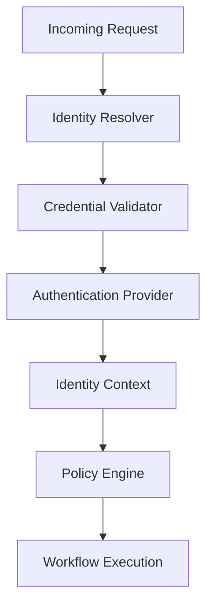
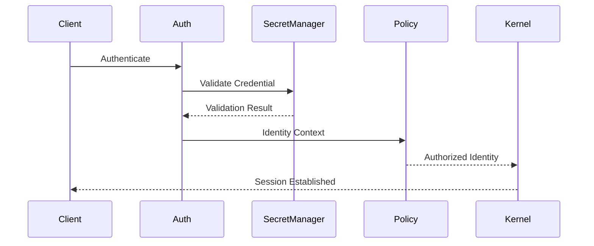

# Identity and Authentication

## Executive Summary

Identity is the foundation of the Hermes AIOS security model. Every privileged action originates from an authenticated principal whose identity can be verified, authorized, audited, and traced throughout workflow execution.

Hermes AIOS separates identity verification (authentication) from permission evaluation (authorization). Authentication establishes **who** is making a request, while the Policy Engine determines **what** that identity is permitted to do.

---

# Objectives

The identity system shall:

- Establish trusted identities
- Authenticate every privileged request
- Support offline-first operation
- Separate authentication from authorization
- Protect credentials
- Support service identities
- Support plugin identities
- Support provider authentication
- Enable future federation
- Produce complete audit records

---

# Design Principles

- Zero Trust
- Explicit identity verification
- Least privilege
- Offline-first
- Secure defaults
- Short-lived credentials
- Immutable identity records
- Configuration-driven authentication

---

# Identity Domains

Hermes AIOS recognizes the following principal types:

- Local user
- Administrator
- Service
- Plugin
- Provider
- Scheduler
- Future remote agent

Each principal has a globally unique identifier.

---

# Identity Model

Each identity contains:

```yaml
identity_id:
principal_type:
display_name:
status:
created_at:
last_authenticated:
authentication_method:
attributes:
```

Identity records are immutable except for lifecycle metadata.

---

# Authentication Architecture

```
Incoming Request
        │
        ▼
Identity Resolver
        │
        ▼
Credential Validator
        │
        ▼
Authentication Provider
        │
        ▼
Identity Context
        │
        ▼
Policy Engine
        │
        ▼
Workflow Execution
```

---

# Authentication Methods

Supported methods:

### Local Authentication

- Password (optional)
- Operating-system identity
- Local secure credential store

### API Authentication

- API keys
- Service tokens

### Future Methods

- OAuth 2.1
- OpenID Connect
- Passkeys
- Hardware security keys
- Mutual TLS
- Enterprise identity providers

Authentication mechanisms are selected through configuration.

---

# Session Management

Authenticated sessions include:

```yaml
session_id:
identity_id:
issued_at:
expires_at:
authentication_level:
device_id:
last_activity:
```

Sessions are renewed according to configurable policies.

---

# Session Lifecycle

```
Authenticate

↓

Create Session

↓

Active

↓

Renew

↓

Expire

or

Revoke
```

Expired sessions cannot be resumed.

---

# Service Identities

Internal services authenticate using dedicated service identities.

Examples:

- Kernel
- Workflow Engine
- Scheduler
- Memory Manager
- Provider Adapter
- Tool Runtime

Service identities never reuse user credentials.

---

# Plugin Identities

Each plugin receives:

- Plugin ID
- Version
- Trust level
- Signing information (future)
- Permission profile

Plugins authenticate through the Plugin Manager before registration.

---

# Provider Authentication

Supported provider credentials:

- API keys
- OAuth tokens
- Service accounts
- Local execution (no remote credentials)

Credentials are resolved through the Secret Manager rather than stored in provider configuration.

---

# Credential Storage

Credentials must:

- Never be hard-coded
- Never appear in logs
- Be encrypted at rest
- Support rotation
- Be scoped to minimum privileges

The Secret Manager is the only supported credential access mechanism.

---

# Authentication Levels

Levels:

| Level | Description |
|--------|-------------|
| Anonymous | Public operations only |
| Authenticated | Standard user |
| Elevated | Administrative functions |
| Service | Internal service identity |
| System | Kernel-controlled operations |

Higher authentication levels do not automatically imply broader authorization.

---

# Credential Rotation

Supported rotation events:

- Manual rotation
- Scheduled rotation
- Provider-triggered rotation
- Emergency rotation

Rotation invalidates superseded credentials without affecting identity records.

---

# Revocation

Revocation triggers:

- Credential compromise
- User request
- Security incident
- Plugin removal
- Provider deauthorization

Revoked credentials immediately terminate active sessions where applicable.

---

# Identity Context

Authenticated requests carry an immutable identity context:

```yaml
identity_id:
principal_type:
roles:
attributes:
session_id:
authentication_level:
issued_at:
```

The Policy Engine consumes this context for authorization decisions.

---

# Authentication Events

Representative events:

```
identity.created

authentication.started

authentication.succeeded

authentication.failed

session.created

session.renewed

session.revoked

credential.rotated
```

All events are published to the Event Bus.

---

# Failure Handling

Authentication failures include:

- Invalid credentials
- Expired credentials
- Revoked credentials
- Unsupported method
- Identity disabled
- Secret unavailable

Recovery actions:

- Retry (where appropriate)
- Credential refresh
- Secret reload
- Administrative intervention

Authentication failures never bypass policy enforcement.

---

# Observability

Metrics include:

- Authentication success rate
- Authentication latency
- Failed authentication count
- Active sessions
- Session duration
- Credential rotations
- Revocation events
- Identity creation rate

These metrics integrate with the Observability subsystem.

---

# Mermaid Flow Diagram



---

# Mermaid Sequence Diagram



---

# Architecture Decisions

## Authentication Before Authorization

Every privileged request establishes identity before the Policy Engine evaluates permissions.

## Dedicated Service Identities

Internal components authenticate independently, reducing credential sharing and improving auditability.

## Secret Manager Integration

Credentials are resolved through the Secret Manager, minimizing exposure and simplifying rotation.

## Immutable Identity Context

Workflow execution receives a stable identity snapshot, ensuring deterministic authorization throughout execution.

## Offline-First Design

Local authentication remains available even when external identity providers are unavailable.

---

# Future Enhancements

- Passkey support
- Multi-factor authentication
- Enterprise SSO
- Hardware-backed credentials
- Identity federation
- Device trust scoring
- Risk-based authentication
- Continuous authentication

---

# Cross References

Previous:

- `docs/security/07_SECURITY_MODEL.md`

Next:

- `docs/security/07_2_AUTHORIZATION_AND_POLICY.md`
