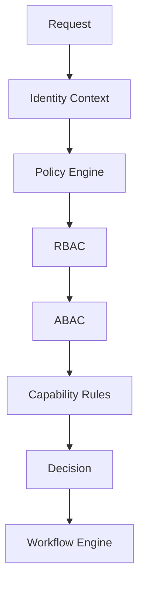
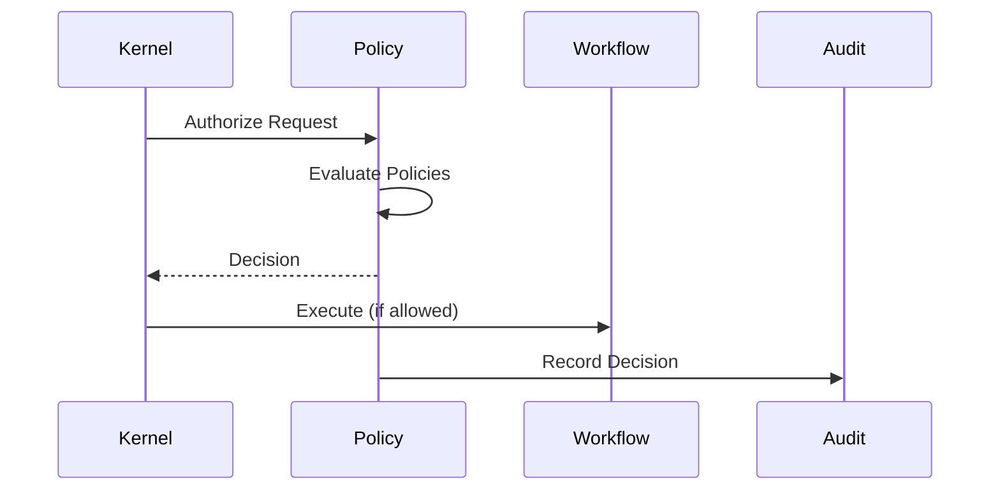

# Authorization and Policy

## Executive Summary

The Policy Engine is the centralized authorization authority for Hermes AIOS. Every request that accesses protected resources or performs privileged operations is evaluated against a consistent set of policies before execution.

Hermes AIOS combines Role-Based Access Control (RBAC), Attribute-Based Access Control (ABAC), capability-aware rules, and workflow context to make deterministic authorization decisions. Authentication establishes identity; authorization determines whether the requested operation is permitted.

---

# Objectives

The authorization subsystem shall:

- Enforce least privilege
- Centralize authorization logic
- Support RBAC and ABAC
- Evaluate capability-specific policies
- Govern tool and provider access
- Protect sensitive resources
- Enable dynamic policy updates
- Produce auditable decisions
- Remain deterministic
- Support future enterprise policy providers

---

# Design Principles

- Deny by default
- Explicit allow rules
- Least privilege
- Policy before execution
- Context-aware decisions
- Immutable decision records
- Versioned policies
- Configuration-driven enforcement

---

# Authorization Architecture

```
Incoming Request
        │
        ▼
Identity Context
        │
        ▼
Policy Engine
        │
 ┌──────┼────────┐
 ▼      ▼        ▼
RBAC   ABAC   Capability Rules
        │
        ▼
Decision Aggregation
        │
        ▼
Allow / Deny / Require Approval / Modify
        │
        ▼
Workflow Execution
```

---

# Authorization Inputs

Every decision evaluates:

- Identity
- Principal type
- Roles
- Attributes
- Requested capability
- Requested resource
- Workflow context
- Plugin trust level
- Provider classification
- Current policy version
- Environmental conditions

---

# Policy Evaluation Pipeline

```
Receive Request
      │
      ▼
Load Applicable Policies
      │
      ▼
Validate Identity
      │
      ▼
Evaluate RBAC
      │
      ▼
Evaluate ABAC
      │
      ▼
Evaluate Capability Rules
      │
      ▼
Resolve Conflicts
      │
      ▼
Return Decision
```

---

# Decision Outcomes

The Policy Engine returns one of four outcomes:

| Outcome | Meaning |
|---------|---------|
| Allow | Execute immediately |
| Deny | Reject request |
| RequireApproval | Pause until approved |
| Modify | Continue with additional restrictions |

Every outcome includes an explanation code.

---

# Role-Based Access Control (RBAC)

Default roles:

- Administrator
- Developer
- Operator
- User
- Plugin
- Service

Example:

```yaml
role: developer

permissions:
  - workflow.execute
  - plugin.install
  - provider.configure

deny:
  - security.override
```

Roles define baseline permissions only.

---

# Attribute-Based Access Control (ABAC)

Policy attributes may include:

- Resource owner
- Project ID
- Environment
- Device trust
- Network location
- Data classification
- Time constraints
- Authentication level
- Workflow type

Example:

```yaml
if:
  resource.classification == "restricted"
  and
  authentication_level < elevated

decision:
  deny
```

---

# Capability Policies

Capabilities may require additional authorization.

Examples:

- shell
- filesystem.write
- network.external
- plugin.install
- provider.remote
- secrets.read
- gpu.compute

Capability policies are evaluated after RBAC and ABAC.

---

# Resource Ownership

Ownership rules:

- Users own personal memories
- Projects own project knowledge
- Plugins own private configuration
- System resources require administrative rights

Ownership is resolved before capability evaluation.

---

# Workflow-Time Authorization

Policies are evaluated:

- Workflow creation
- Task scheduling
- Tool execution
- Provider invocation
- Memory persistence
- Plugin execution
- Workflow resumption

Long-running workflows are revalidated at defined checkpoints.

---

# Permission Inheritance

Inheritance follows:

```
System
   │
Role
   │
Project
   │
Workflow
   │
Task
```

Lower scopes may further restrict permissions but cannot exceed higher-level limits.

---

# Dynamic Policy Updates

Policies may be updated without restarting Hermes AIOS.

Supported updates:

- Role definitions
- Capability rules
- Resource classifications
- Provider restrictions
- Plugin trust mappings

Running workflows continue using the policy version captured at authorization unless a mandatory revalidation point is reached.

---

# Policy Versioning

Every policy set includes:

```yaml
policy_id:
version:
effective_from:
checksum:
author:
```

Policy history is immutable and retained for audit purposes.

---

# Conflict Resolution

When multiple policies apply:

1. Explicit deny
2. Mandatory restrictions
3. Explicit allow
4. Default deny

Conflict resolution is deterministic and documented.

---

# Audit Logging

Each authorization decision records:

- Decision ID
- Identity ID
- Resource
- Capability
- Decision
- Policy version
- Evaluation time
- Explanation code

Audit records are append-only.

---

# Failure Handling

Failure scenarios:

- Missing policy
- Invalid policy
- Policy service unavailable
- Attribute resolution failure
- Identity mismatch

Recovery options:

- Retry policy load
- Fallback to cached policy
- Deny by default
- Administrative alert

Authorization never fails open.

---

# Observability

Metrics:

- Authorization latency
- Allow/deny ratio
- Policy cache hit rate
- Capability denials
- Policy reload count
- Decision throughput
- Approval requests

These metrics integrate with the Observability subsystem.

---

# Mermaid Flow Diagram



---

# Mermaid Sequence Diagram



---

# Architecture Decisions

## Centralized Policy Evaluation

All authorization decisions are made through the Policy Engine to eliminate inconsistent permission handling.

## Deny-by-Default

Requests are rejected unless explicitly authorized, reducing the risk of unintended access.

## Layered Authorization

RBAC, ABAC, and capability-specific rules complement each other, enabling both coarse-grained and fine-grained control.

## Immutable Decision Records

Authorization decisions are permanently recorded to support auditing, debugging, and compliance.

## Runtime Revalidation

Long-running workflows may require policy re-evaluation at checkpoints to account for changing security conditions.

---

# Future Enhancements

- Policy-as-Code language
- External policy providers
- Continuous authorization
- Risk-adaptive policies
- Fine-grained delegation
- Multi-tenant policy domains
- Graph-based authorization
- Formal policy verification

---

# Cross References

Previous:

- `docs/security/07_1_IDENTITY_AND_AUTHENTICATION.md`

Next:

- `docs/security/07_3_SECRET_MANAGEMENT.md`
