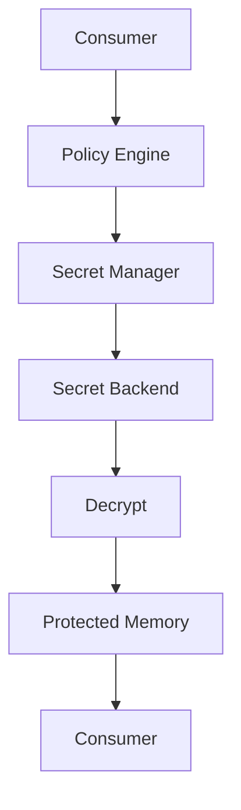
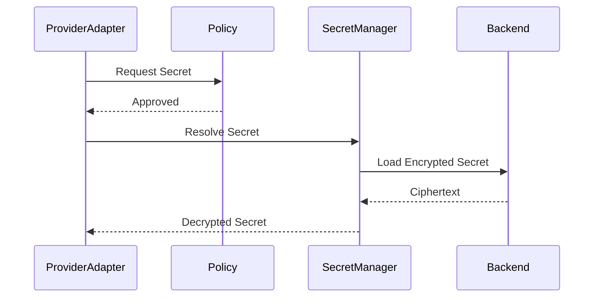

# Secret Management

## Executive Summary

The Secret Manager is the authoritative subsystem responsible for protecting confidential values used by Hermes AIOS. Rather than allowing components to manage credentials directly, every secret is accessed through a unified interface that enforces authentication, authorization, auditing, encryption, and lifecycle management.

The Secret Manager isolates sensitive data from application code and configuration while enabling secure local-first operation.

---

# Objectives

The Secret Manager shall:

- Securely store secrets
- Encrypt all persisted secrets
- Support secret rotation
- Provide least-privilege access
- Prevent secret leakage
- Audit every access
- Support multiple secret backends
- Enable secure workflow injection
- Support disaster recovery
- Remain provider independent

---

# Design Principles

- Never hard-code secrets
- Encrypt before persistence
- Deny direct access
- Least privilege
- Audit every operation
- Separate metadata from secret values
- Support offline-first deployments
- Pluggable secret backends

---

# Secret Types

Supported secret categories include:

- Provider API keys
- OAuth tokens
- Service account credentials
- Encryption keys
- Database credentials
- Plugin secrets
- Signing keys
- Certificates
- SSH keys
- Webhook secrets

Each secret has an immutable identifier.

---

# Secret Lifecycle

```
Create
   │
Validate
   │
Encrypt
   │
Store
   │
Access
   │
Rotate
   │
Revoke
   │
Archive
   │
Destroy
```

Lifecycle events are published to the Event Bus.

---

# Secret Model

Each secret record contains:

```yaml
secret_id:
name:
category:
owner:
scope:
backend:
created_at:
expires_at:
rotation_policy:
classification:
metadata:
```

The secret value is never stored in plaintext.

---

# Secret Backends

Supported implementations:

- Encrypted local store
- Operating system credential store
- Future cloud secret manager
- Future hardware security module (HSM)

The backend is selected through configuration without changing consuming components.

---

# Encryption

Requirements:

- Encrypt before persistence
- Separate encryption keys from stored secrets
- Integrity verification
- Versioned key identifiers
- Authenticated encryption algorithms

Key material is never written to logs or exposed through APIs.

---

# Access Workflow

```
Workflow
      │
      ▼
Policy Engine
      │
      ▼
Secret Manager
      │
      ▼
Backend
      │
      ▼
Decryption
      │
      ▼
Secure Memory
      │
      ▼
Consumer
```

Consumers receive secrets only after successful policy evaluation.

---

# Secret Resolution

Consumers request secrets by logical identifier:

```yaml
provider.openrouter.api_key
provider.local.signing_key
database.sqlite.encryption_key
```

The Secret Manager resolves the physical storage location internally.

---

# Access Control

Access decisions evaluate:

- Authenticated identity
- Principal type
- Requested secret
- Secret classification
- Workflow context
- Plugin trust level
- Capability requirements

Default behavior:

```
Deny
```

Explicit policy is required to permit access.

---

# Secure Injection

Secrets are injected into:

- Provider Adapter
- Tool Runtime
- Scheduler
- Plugin execution
- Workflow tasks

Secrets are never embedded in workflow definitions, checkpoints, or persisted execution context.

---

# Rotation

Supported rotation policies:

- Manual
- Scheduled
- On compromise
- Provider-triggered
- Version upgrade

Rotation process:

1. Generate replacement
2. Validate
3. Update backend
4. Notify consumers
5. Revoke previous version
6. Record audit event

---

# Revocation

Revocation triggers include:

- Credential compromise
- User request
- Plugin removal
- Provider deauthorization
- Policy violation
- Scheduled expiration

Revoked secrets cannot be retrieved.

---

# Plugin Isolation

Plugins access only secrets explicitly granted through policy.

Plugins:

- Cannot enumerate secrets
- Cannot read unrelated credentials
- Cannot export secret values
- Cannot bypass Secret Manager APIs

---

# Provider Integration

Provider Adapter requests credentials only when preparing execution.

Credentials are:

- Loaded on demand
- Cached only for the minimum required duration
- Cleared from memory after use

---

# Memory Handling

Decrypted secrets reside only in protected runtime memory.

Requirements:

- No persistence
- No serialization
- No checkpoint inclusion
- No event publication
- No structured logging

---

# Audit Logging

Every secret operation records:

- Secret ID
- Identity ID
- Operation
- Timestamp
- Policy decision
- Backend
- Outcome

Secret values are never recorded.

---

# Recovery

Recovery scenarios:

- Backend unavailable
- Corrupted metadata
- Lost encryption key
- Rotation interruption

Recovery actions:

- Retry
- Restore from backup
- Reconstruct metadata
- Administrative escalation

Recovery procedures preserve audit history.

---

# Failure Handling

Failure categories:

- Unauthorized access
- Backend failure
- Decryption failure
- Expired secret
- Revoked secret
- Integrity verification failure

Failure responses never reveal secret contents.

---

# Observability

Metrics:

- Secret retrieval latency
- Access count
- Rotation count
- Revocation count
- Backend availability
- Audit event volume
- Failed access attempts

Metrics integrate with the Observability subsystem.

---

# Mermaid Flow Diagram



---

# Mermaid Sequence Diagram



---

# Architecture Decisions

## Centralized Secret Authority

All secret operations are routed through the Secret Manager to eliminate inconsistent handling across components.

## Backend Abstraction

Consumers remain independent of the underlying storage technology, enabling future backend replacements without code changes.

## Just-in-Time Resolution

Secrets are retrieved only when required and retained in memory for the shortest practical duration.

## Deny-by-Default Access

Secret access requires explicit authorization through the Policy Engine, minimizing accidental exposure.

## Comprehensive Auditing

Every lifecycle operation is logged without exposing sensitive values, supporting incident response and compliance.

---

# Future Enhancements

- Hardware security module integration
- Automatic provider key rotation
- Secret leasing
- Envelope encryption
- Multi-region replication
- Threshold key management
- Secret health dashboards
- Automated compromise detection

---

# Cross References

Previous:

- `docs/security/07_2_AUTHORIZATION_AND_POLICY.md`

Next:

- `docs/security/07_4_DATA_PROTECTION.md`
