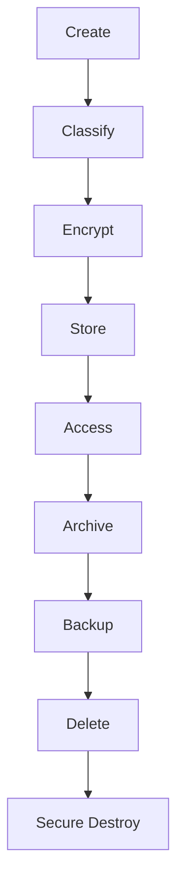
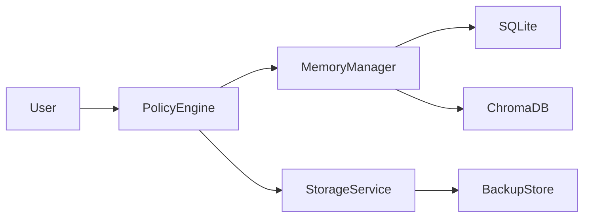

# Data Protection

## Executive Summary

Data protection in Hermes AIOS extends across every subsystem—from request processing and memory storage to workflow checkpoints, provider interactions, audit logs, and backups. Protection mechanisms are applied according to data classification and enforced through the Policy Engine.

The design follows confidentiality, integrity, availability, and privacy-by-design principles while remaining compatible with local-first deployments.

---

# Objectives

The Data Protection subsystem shall:

- Classify all persisted data
- Encrypt sensitive information
- Protect data integrity
- Secure data in transit
- Support retention policies
- Enable secure deletion
- Protect backups
- Enforce privacy controls
- Support compliance requirements
- Integrate with observability and auditing

---

# Design Principles

- Privacy by Design
- Encrypt by Default
- Least Data Retention
- Integrity Verification
- Explicit Data Ownership
- Configuration-Driven Policies
- Secure Disposal
- Defense in Depth

---

# Data Classification

Every stored object belongs to one of the following classes:

| Classification | Description | Examples |
|----------------|-------------|----------|
| Public | Freely shareable | Documentation, licenses |
| Internal | Operational data | Metrics, configuration metadata |
| Confidential | User and project data | Conversations, memories |
| Sensitive | Credentials and secrets | API keys, tokens |
| Restricted | Highly protected assets | Encryption keys, recovery material |

Classification is attached as metadata and consumed by the Policy Engine.

---

# Protected Data Types

The system protects:

- User conversations
- Long-term memory
- Workflow checkpoints
- Event logs
- Configuration files
- Provider credentials
- Audit records
- Plugin configuration
- Embeddings
- Generated artifacts

Each type inherits controls from its classification.

---

# Data Lifecycle

```
Create
   │
Classify
   │
Protect
   │
Store
   │
Access
   │
Update
   │
Archive
   │
Backup
   │
Delete
   │
Destroy
```

Every transition is auditable.

---

# Encryption at Rest

Protected storage includes:

- SQLite databases
- ChromaDB indexes
- Backup archives
- Secret backends
- Configuration snapshots
- Audit logs

Requirements:

- Authenticated encryption
- Versioned key identifiers
- Integrity verification
- Secure key separation

The Secret Manager provides encryption material.

---

# Encryption in Transit

All network communication carrying protected information shall use authenticated, encrypted channels.

Examples:

- Provider APIs
- Remote storage
- Future distributed nodes
- Administrative interfaces

Transport security settings are centrally configured.

---

# Integrity Protection

Protected assets include:

- Configuration
- Checkpoints
- Policies
- Audit logs
- Plugin manifests
- Event records

Integrity controls may include:

- Cryptographic hashes
- Digital signatures
- Checksums
- Version validation

Integrity verification occurs before consumption.

---

# Data Ownership

Ownership model:

| Resource | Owner |
|----------|-------|
| Personal memory | User |
| Project memory | Project |
| Configuration | Administrator |
| Audit logs | System |
| Plugin data | Plugin (subject to policy) |
| Workflow state | Workflow |

Ownership influences authorization decisions.

---

# Retention Policies

Default retention classes:

- Ephemeral
- Short-term
- Standard
- Long-term
- Permanent

Examples:

| Data | Retention |
|------|-----------|
| Workflow scratch data | Ephemeral |
| Conversation context | Standard |
| User-approved memories | Long-term |
| Audit logs | Permanent (policy dependent) |

Retention policies are configurable.

---

# Secure Deletion

Deletion process:

1. Authorize request
2. Locate data
3. Remove references
4. Securely erase storage where supported
5. Update indexes
6. Record audit event

Deleted data shall not remain accessible through application interfaces.

---

# Backup Protection

Backup requirements:

- Encryption before storage
- Integrity verification
- Version metadata
- Access control
- Periodic restore testing

Backups inherit the highest classification of contained data.

---

# Privacy Controls

Privacy features include:

- Data minimization
- Explicit user approval for long-term memory
- Configurable retention
- Export controls
- Deletion requests
- Restricted provider sharing

Sensitive information is shared externally only when explicitly permitted by policy.

---

# Memory Protection

The Memory Manager shall:

- Respect data classifications
- Enforce retention policies
- Prevent unauthorized retrieval
- Protect embeddings
- Preserve provenance

Memory exports require policy approval.

---

# Provider Data Handling

Before provider execution:

- Remove unnecessary context
- Apply classification rules
- Validate provider trust level
- Enforce external-sharing policy

Local providers are preferred whenever policy permits.

---

# Checkpoint Protection

Workflow checkpoints include:

- Encryption
- Integrity verification
- Version metadata
- Access control
- Retention enforcement

Checkpoint restoration validates integrity before execution resumes.

---

# Audit Integration

Data-related events include:

```
data.created

data.classified

data.encrypted

data.accessed

data.retained

data.deleted

backup.created

backup.restored
```

Sensitive values are never included in audit payloads.

---

# Failure Handling

Failure scenarios:

- Encryption failure
- Integrity mismatch
- Corrupted backup
- Unauthorized access
- Retention policy conflict
- Storage corruption

Recovery actions:

- Retry
- Restore from backup
- Reject operation
- Quarantine affected data
- Administrative alert

---

# Observability

Metrics include:

- Encryption latency
- Backup duration
- Restore success rate
- Integrity verification failures
- Secure deletion count
- Data export requests
- Retention policy executions

Metrics integrate with the Observability subsystem.

---

# Mermaid Data Lifecycle



---

# Mermaid Trust Flow



---

# Architecture Decisions

## Classification-Driven Protection

Every object is protected according to its assigned classification, allowing consistent enforcement across all storage technologies.

## Encryption by Default

Protected data is encrypted before persistence and remains encrypted during backup operations.

## Privacy-First Memory Management

Long-term memory creation requires explicit approval, and provider interactions minimize shared context.

## Policy-Coupled Data Access

All data access passes through authorization and classification checks before retrieval or modification.

## Lifecycle Governance

Retention, archival, backup, and deletion are managed through explicit lifecycle policies rather than ad hoc application behavior.

---

# Future Enhancements

- Field-level encryption
- Confidential computing support
- Differential privacy for analytics
- Automated data lineage
- Cross-device encrypted synchronization
- Immutable backup verification
- Policy-based geographic residency
- Continuous data classification

---

# Cross References

Previous:

- `docs/security/07_3_SECRET_MANAGEMENT.md`

Next:

- `docs/security/07_5_PLUGIN_TRUST_AND_SUPPLY_CHAIN.md`
