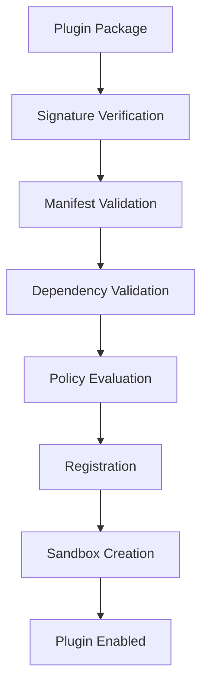
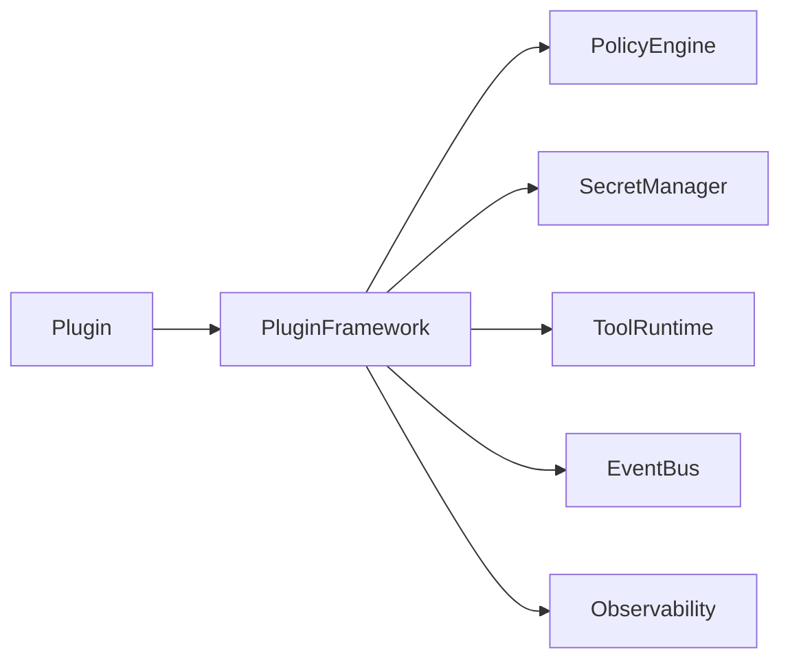

# Plugin Trust and Supply Chain Security

## Executive Summary

Hermes AIOS is designed as an extensible platform where plugins can introduce new capabilities without compromising system integrity. Every plugin is treated as an untrusted component until it has been verified, authorized, and assigned an explicit trust level.

The Plugin Framework, Policy Engine, Secret Manager, Tool Runtime, and Observability subsystem work together to enforce a secure software supply chain from package creation through runtime execution.

---

# Objectives

The plugin security subsystem shall:

- Verify plugin authenticity
- Validate package integrity
- Enforce runtime isolation
- Restrict permissions
- Prevent supply-chain attacks
- Support trusted updates
- Audit plugin behavior
- Allow rapid revocation
- Generate Software Bills of Materials (SBOM)
- Remain configuration-driven

---

# Design Principles

- Zero Trust
- Verify Before Install
- Least Privilege
- Reproducible Builds
- Signed Artifacts
- Immutable Package Identity
- Defense in Depth
- Secure by Default

---

# Plugin Lifecycle

```
Develop
   │
Package
   │
Sign
   │
Publish
   │
Verify
   │
Install
   │
Authorize
   │
Execute
   │
Update
   │
Revoke
   │
Remove
```

Every stage is auditable.

---

# Trust Levels

Plugins are assigned one of the following trust levels:

| Level | Description |
|--------|-------------|
| Core | Distributed with Hermes AIOS |
| Trusted | Officially maintained or approved |
| Verified | Signature validated but third-party |
| Community | Public plugins with limited trust |
| Experimental | Unverified development plugins |

Trust level influences available permissions.

---

# Plugin Identity

Each plugin contains immutable metadata:

```yaml
plugin_id:
name:
version:
publisher:
signature:
manifest_version:
trust_level:
checksum:
```

The `plugin_id` is globally unique.

---

# Package Manifest

Every plugin package includes:

```yaml
name:
version:
description:
publisher:
entrypoint:
capabilities:
permissions:
dependencies:
minimum_hermes_version:
signature:
```

Installation fails if required fields are missing or invalid.

---

# Package Signing

Requirements:

- Cryptographic signature
- Publisher identity
- Version binding
- Manifest integrity
- Hash verification

Unsigned plugins cannot be installed unless explicitly allowed by development policy.

---

# Integrity Verification

Before installation Hermes AIOS validates:

- Package checksum
- Manifest checksum
- Signature validity
- Dependency integrity
- Version compatibility

Verification occurs before any code executes.

---

# Dependency Validation

Dependencies are checked for:

- Version constraints
- Known vulnerabilities
- Compatibility
- Circular references
- License policy

Failed validation blocks installation.

---

# Software Bill of Materials (SBOM)

Each plugin produces an SBOM containing:

- Direct dependencies
- Transitive dependencies
- Versions
- Licenses
- Source references
- Hashes

SBOMs support vulnerability scanning and compliance.

---

# Installation Policy

Installation pipeline:

```
Package
   │
Verify Signature
   │
Validate Manifest
   │
Resolve Dependencies
   │
Policy Evaluation
   │
Register Plugin
   │
Assign Trust Level
   │
Enable Runtime
```

The Policy Engine may reject installation at any stage.

---

# Runtime Isolation

Plugins execute within isolated environments.

Isolation controls include:

- Filesystem restrictions
- Network policy
- CPU and memory quotas
- Tool permission filtering
- Secret isolation
- Event subscription filtering

Plugins never execute with Kernel privileges.

---

# Permission Model

Plugins request capabilities rather than unrestricted access.

Examples:

- filesystem.read
- filesystem.write
- provider.invoke
- network.external
- tool.python
- memory.lookup
- memory.persist

Permissions are explicitly granted through policy.

---

# Secret Access

Plugins:

- Cannot enumerate secrets
- Receive only approved secrets
- Access secrets through the Secret Manager
- Never receive raw backend credentials

Secrets remain outside plugin storage.

---

# Update Verification

Plugin updates require:

- Signature validation
- Compatibility verification
- Dependency validation
- Policy approval
- Rollback checkpoint

Failed updates automatically revert to the previous verified version.

---

# Revocation

Revocation may occur because of:

- Signature compromise
- Publisher compromise
- Security vulnerability
- Policy violation
- User request

Revoked plugins:

- Stop accepting new work
- Complete or terminate active tasks according to policy
- Are prevented from future execution
- Generate audit events

---

# Supply Chain Protection

Controls include:

- Signed releases
- Manifest verification
- SBOM generation
- Dependency validation
- Hash verification
- Trusted publisher registry
- Vulnerability scanning
- Version pinning

---

# Audit Logging

Every lifecycle event records:

- Plugin ID
- Version
- Publisher
- Trust level
- Operation
- Timestamp
- Decision
- Policy version

Plugin code and secrets are never written to audit logs.

---

# Failure Handling

Failure scenarios:

- Invalid signature
- Manifest corruption
- Dependency conflict
- Trust policy violation
- Runtime isolation failure
- Revoked publisher
- SBOM generation failure

Recovery actions:

- Reject installation
- Roll back update
- Disable plugin
- Notify administrators
- Quarantine package

---

# Observability

Metrics:

- Installed plugins
- Trust-level distribution
- Verification failures
- Update success rate
- Revocation count
- Runtime violations
- Dependency vulnerability count

These metrics integrate with the Observability subsystem.

---

# Mermaid Installation Flow



---

# Mermaid Runtime Architecture



---

# Architecture Decisions

## Zero-Trust Plugin Model

All plugins begin as untrusted software. Trust is established through cryptographic verification, policy evaluation, and runtime isolation.

## Signed Distribution

Every distributable plugin is cryptographically signed, enabling publisher verification and integrity validation.

## Capability-Based Permissions

Plugins request narrowly scoped capabilities rather than unrestricted access, reducing the impact of compromised extensions.

## Runtime Sandboxing

Plugins execute inside isolated environments with explicit resource and permission boundaries.

## Supply-Chain Transparency

SBOM generation, dependency validation, and version pinning improve visibility into third-party software risk.

---

# Future Enhancements

- Sigstore integration
- Reproducible build verification
- Automatic CVE monitoring
- Trusted plugin marketplace
- Hardware-backed publisher signing
- Continuous dependency risk scoring
- Runtime behavior anomaly detection
- Remote attestation for plugins

---

# Cross References

Previous:

- `docs/security/07_4_DATA_PROTECTION.md`

Next:

- `docs/security/07_6_AUDIT_AND_COMPLIANCE.md`
