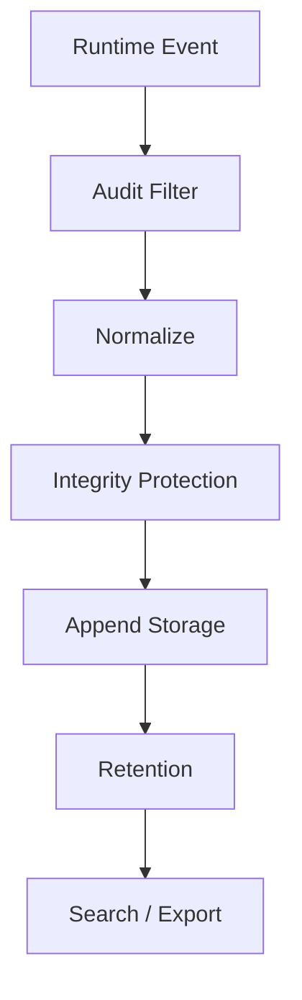
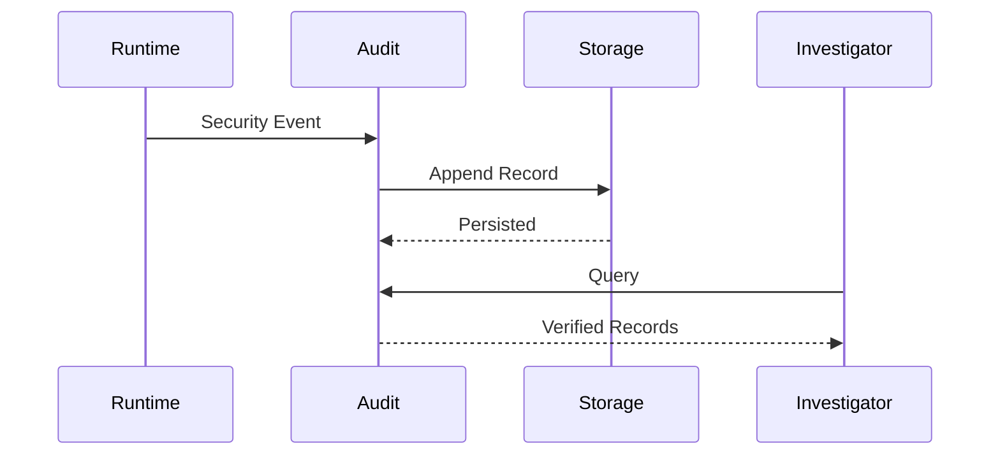

# Audit and Compliance

## Executive Summary

Hermes AIOS maintains an immutable audit trail for all security-sensitive and governance-relevant operations. Audit records support incident response, operational troubleshooting, forensic analysis, regulatory reporting, and long-term accountability.

Audit logging is distinct from operational logging. Operational logs optimize debugging and performance monitoring, while audit logs preserve security-relevant historical facts.

---

# Objectives

The Audit subsystem shall:

- Record security events
- Preserve audit integrity
- Prevent unauthorized modification
- Support forensic investigations
- Enable compliance reporting
- Provide configurable retention
- Export audit records
- Correlate events across subsystems
- Integrate with observability
- Support future enterprise governance

---

# Design Principles

- Append-only storage
- Tamper evidence
- Time synchronization
- Immutable records
- Least-privilege access
- Policy-controlled retention
- Cryptographic integrity
- Deterministic event correlation

---

# Audit Scope

Audit records are generated for:

- Authentication
- Authorization
- Secret access
- Policy changes
- Configuration changes
- Plugin lifecycle
- Provider selection
- Tool execution
- Workflow approval
- Data deletion
- Backup operations
- Recovery actions

---

# Audit Pipeline

```
Runtime Event
      │
      ▼
Audit Filter
      │
      ▼
Normalize Record
      │
      ▼
Integrity Protection
      │
      ▼
Append Storage
      │
      ▼
Retention Management
      │
      ▼
Search / Export
```

---

# Audit Record Schema

Each audit record contains:

```yaml
audit_id:
timestamp:
event_type:
actor_id:
principal_type:
workflow_id:
request_id:
resource:
action:
result:
policy_version:
correlation_id:
integrity_hash:
metadata:
```

Sensitive values are never stored directly in audit records.

---

# Event Sources

Primary producers include:

- Kernel
- Policy Engine
- Identity Service
- Secret Manager
- Workflow Engine
- Memory Manager
- Tool Runtime
- Provider Adapter
- Plugin Manager
- Recovery Manager

Every producer emits standardized audit events.

---

# Integrity Protection

Audit integrity requirements:

- Append-only writes
- Cryptographic hash chain
- Versioned schema
- Integrity verification
- Timestamp validation

Integrity verification occurs before audit export and restoration.

---

# Retention Policies

Retention classes:

| Class | Typical Duration |
|------|-------------------|
| Operational | Configurable |
| Security | Long-term |
| Compliance | Policy-defined |
| Permanent | Never automatically deleted |

Retention periods are configurable by deployment.

---

# Access Control

Audit access requires:

- Authenticated identity
- Explicit authorization
- Audit-read capability
- Policy approval for sensitive records

Default access is denied.

---

# Search and Investigation

Supported queries:

- By identity
- By workflow
- By request
- By plugin
- By provider
- By capability
- By time range
- By event category

Search operations themselves generate audit events.

---

# Correlation

Audit records share common identifiers:

- request_id
- workflow_id
- correlation_id
- session_id

These identifiers enable reconstruction of complete execution histories.

---

# Export

Supported export formats:

- JSON
- NDJSON
- CSV
- Future SIEM connectors

Exported records preserve integrity metadata and schema version.

---

# Compliance Mapping

The architecture supports mapping controls to organizational or regulatory frameworks through configuration.

Example compliance domains:

- Access control
- Auditability
- Data protection
- Change management
- Incident response
- Business continuity

Framework-specific mappings remain deployment-specific.

---

# Incident Investigation

Typical investigation workflow:

```
Incident
    │
Identify Correlation ID
    │
Retrieve Audit Records
    │
Verify Integrity
    │
Reconstruct Timeline
    │
Generate Report
```

---

# Failure Handling

Failure scenarios:

- Storage unavailable
- Integrity mismatch
- Retention conflict
- Export failure
- Timestamp inconsistency

Recovery actions:

- Queue writes
- Retry persistence
- Alert operators
- Verify backup copies
- Restore audit store

Audit failures never silently discard security events.

---

# Observability

Metrics include:

- Audit write latency
- Audit queue depth
- Integrity verification failures
- Export count
- Search latency
- Retention execution count
- Audit storage utilization

These metrics integrate with the Observability subsystem.

---

# Mermaid Flow Diagram



---

# Mermaid Sequence Diagram



---

# Architecture Decisions

## Dedicated Audit Store

Audit data is logically separated from operational logs to preserve integrity and simplify governance.

## Append-Only Records

Audit entries are immutable after creation, supporting trustworthy forensic analysis.

## Correlated Execution History

Shared identifiers allow complete reconstruction of requests and workflows across runtime subsystems.

## Policy-Governed Access

Audit visibility is controlled through the Policy Engine to protect sensitive operational information.

## Export Without Modification

Exports preserve original integrity metadata and schema versions to maintain evidentiary value.

---

# Future Enhancements

- WORM storage support
- SIEM integrations
- Automated compliance reporting
- Digital signatures on audit batches
- Cross-node audit replication
- Risk scoring dashboards
- Continuous compliance monitoring
- AI-assisted incident analysis

---

# Cross References

Previous:

- `docs/security/07_5_PLUGIN_TRUST_AND_SUPPLY_CHAIN.md`

Next:

- `docs/security/07_7_THREAT_MODEL.md`
