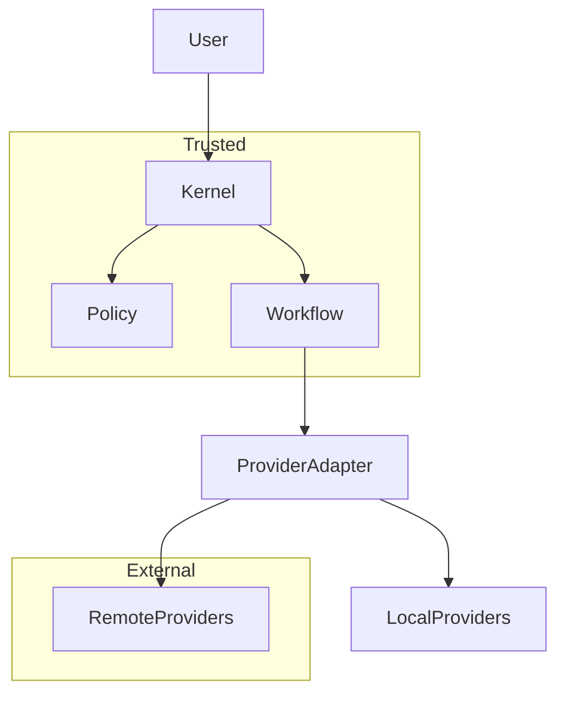
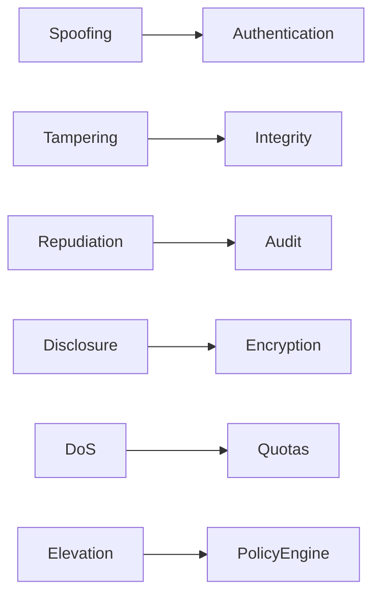

# Threat Model

## Executive Summary

The Hermes AIOS Threat Model identifies threats against the platform, evaluates their potential impact, documents mitigation strategies, and defines residual risks accepted by the project. The model follows a defense-in-depth philosophy and complements the Security Model, Policy Engine, Identity system, Secret Manager, and Plugin Framework.

Threat modeling is a living process and shall be updated whenever new capabilities, providers, plugins, or deployment models are introduced.

---

# Objectives

The Threat Model shall:

- Identify critical assets
- Define trust boundaries
- Classify threat actors
- Analyze attack surfaces
- Apply STRIDE methodology
- Map security controls
- Document residual risks
- Support security reviews
- Guide implementation
- Inform testing strategies

---

# Design Principles

- Security by Design
- Zero Trust
- Least Privilege
- Defense in Depth
- Secure Defaults
- Explicit Trust Boundaries
- Continuous Validation
- Risk-Based Prioritization

---

# Critical Assets

Protected assets include:

- User data
- Long-term memory
- Workflow definitions
- Provider credentials
- Secret storage
- Policy definitions
- Audit records
- Plugin packages
- Runtime configuration
- Recovery checkpoints
- Cryptographic keys

Assets are classified according to the Data Protection policy.

---

# Trust Boundaries

Primary trust boundaries:

```
User Interface
      │
      ▼
Hermes Kernel
      │
 ┌────┼────┐
 ▼    ▼    ▼
Policy Memory Workflow
      │
      ▼
Provider Adapter
      │
 ┌────┴────┐
 ▼         ▼
Local     Remote
Providers Providers
```

Every boundary crossing requires authentication, authorization, and validation.

---

# Threat Actors

Representative actors:

| Actor | Motivation |
|--------|------------|
| Anonymous attacker | Opportunistic compromise |
| Malicious user | Privilege escalation |
| Compromised plugin | Unauthorized access |
| Compromised provider | Data exfiltration |
| Insider | Abuse of legitimate access |
| Supply-chain attacker | Software compromise |
| Malware | Credential theft |
| Automated bots | Resource exhaustion |

---

# Attack Surfaces

Primary attack surfaces:

- User interfaces
- API endpoints
- Plugin packages
- Provider integrations
- Tool Runtime
- Configuration files
- Secret backends
- Storage systems
- Event Bus
- Update mechanism
- Workflow imports

Attack surfaces are minimized by default.

---

# STRIDE Analysis

## Spoofing

Threats:

- Identity impersonation
- Service impersonation
- Provider impersonation

Controls:

- Strong authentication
- Service identities
- Credential validation
- Signed requests
- Mutual authentication (future)

Residual Risk:

Low

---

## Tampering

Threats:

- Configuration modification
- Plugin alteration
- Checkpoint corruption
- Audit manipulation

Controls:

- Integrity verification
- Digital signatures
- Checksums
- Immutable audit storage
- Configuration validation

Residual Risk:

Low

---

## Repudiation

Threats:

- Denial of performed actions
- Missing accountability

Controls:

- Immutable audit logs
- Correlation identifiers
- Timestamped events
- Identity propagation

Residual Risk:

Low

---

## Information Disclosure

Threats:

- Secret leakage
- Memory exposure
- Unauthorized provider sharing
- Sensitive log entries

Controls:

- Secret Manager
- Encryption
- Policy enforcement
- Context minimization
- Secure logging

Residual Risk:

Medium (external providers remain a trust dependency)

---

## Denial of Service

Threats:

- Provider exhaustion
- Infinite workflows
- Event queue saturation
- Plugin abuse

Controls:

- Rate limiting
- Resource quotas
- Circuit breakers
- Workflow timeouts
- Queue monitoring

Residual Risk:

Medium

---

## Elevation of Privilege

Threats:

- Plugin privilege escalation
- Policy bypass
- Sandbox escape
- Tool abuse

Controls:

- Capability-based permissions
- Runtime sandboxing
- Policy Engine
- Least privilege
- Continuous authorization

Residual Risk:

Low

---

# Security Control Mapping

| Threat | Primary Controls |
|---------|------------------|
| Identity spoofing | Authentication, service identities |
| Credential theft | Secret Manager, encryption |
| Plugin compromise | Signing, sandboxing, trust levels |
| Data leakage | Policy Engine, classification, encryption |
| Provider failure | Failover, policy, observability |
| Workflow abuse | Authorization, quotas, checkpoints |
| Supply-chain attacks | SBOM, signatures, dependency validation |

---

# Residual Risks

Known residual risks include:

- Trust placed in external AI providers
- Zero-day vulnerabilities in dependencies
- Hardware compromise outside software control
- User-approved disclosure of sensitive information
- Future plugin ecosystem expansion

Residual risks are reviewed during each major release.

---

# Incident Response Integration

Security incidents follow this workflow:

```
Detection
    │
Classification
    │
Containment
    │
Eradication
    │
Recovery
    │
Lessons Learned
```

Every incident generates audit records and recovery metrics.

---

# Security Testing Strategy

Required testing:

- Unit security tests
- Integration security tests
- Authorization tests
- Secret handling validation
- Fuzz testing
- Static analysis
- Dependency scanning
- Plugin verification
- Recovery validation
- Penetration testing

Security tests are integrated into the CI pipeline.

---

# Architecture Review Checklist

Review every release for:

- New trust boundaries
- New attack surfaces
- Policy changes
- Provider changes
- Plugin capability changes
- Secret management updates
- Dependency additions
- Configuration changes
- Recovery process updates

Changes that affect security require an updated threat assessment.

---

# Observability

Security metrics include:

- Authentication failures
- Authorization denials
- Plugin verification failures
- Secret access anomalies
- Provider security events
- Incident count
- Recovery duration
- Mean Time To Detect (MTTD)
- Mean Time To Recover (MTTR)

Metrics integrate with the Observability subsystem.

---

# Mermaid Trust Boundary Diagram



---

# Mermaid STRIDE Overview



---

# Architecture Decisions

## Threat Modeling as a Living Process

Threat assessments evolve alongside architecture, plugins, providers, and deployment environments.

## Defense in Depth

Multiple independent controls reduce the impact of any single control failure.

## Capability-Oriented Security

Authorization decisions are based on capabilities and context rather than component identity alone.

## External Trust Minimization

Remote providers are treated as partially trusted and receive only the minimum required context.

## Continuous Security Validation

Security testing and architecture review are integrated into the development lifecycle.

---

# Future Enhancements

- Automated threat modeling
- Continuous attack-surface analysis
- AI-assisted security review
- Formal verification of security policies
- Runtime anomaly detection
- Threat intelligence integration
- Red-team automation
- Continuous penetration testing

---

# Cross References

Previous:

- `docs/security/07_6_AUDIT_AND_COMPLIANCE.md`

Next:

- `docs/development/08_DEVELOPMENT_GUIDE.md`
