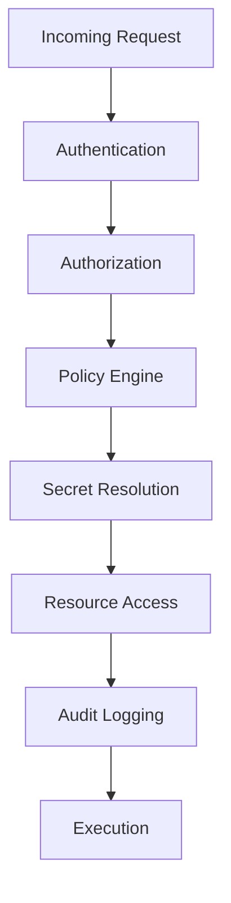
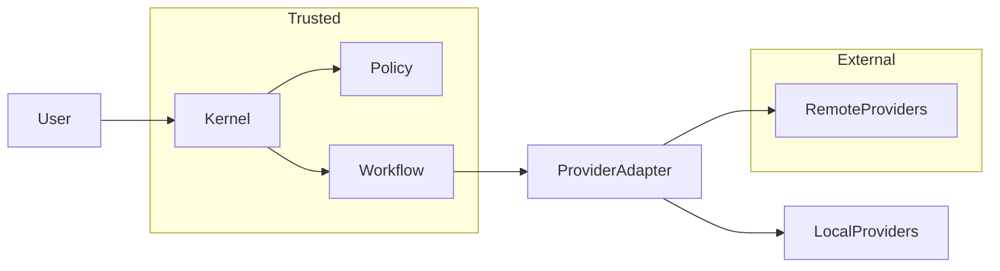

# Security Model

## Executive Summary

Hermes AIOS is designed using a defense-in-depth strategy with a zero-trust mindset. Every request, component, provider, plugin, and tool invocation is authenticated, authorized, audited, and governed by explicit policy.

Security is treated as a cross-cutting concern rather than a standalone subsystem. All runtime components interact with the Policy Engine and Security Services before accessing protected resources.

---

# Security Objectives

Hermes AIOS shall:

- Protect user data
- Enforce least privilege
- Operate securely offline
- Minimize attack surface
- Prevent privilege escalation
- Support secure extensibility
- Provide complete auditability
- Enable policy-driven governance
- Protect secrets
- Support future enterprise deployment

---

# Security Principles

- Zero Trust
- Least Privilege
- Explicit Authorization
- Secure by Default
- Defense in Depth
- Fail Securely
- Immutable Audit Records
- Separation of Duties
- Configuration as Code
- Privacy by Design

---

# Trust Boundaries

Primary trust zones:

```
┌─────────────────────────────┐
│ User Interfaces             │
└──────────────┬──────────────┘
               │
               ▼
┌─────────────────────────────┐
│ Hermes Kernel               │
└──────────────┬──────────────┘
               │
     ┌─────────┼─────────┐
     ▼         ▼         ▼
 Policy    Memory    Workflow
 Engine    Manager   Engine
     │         │         │
     └─────────┼─────────┘
               ▼
        Provider Adapter
               │
      ┌────────┴────────┐
      ▼                 ▼
 Local Providers   Remote Providers
```

Crossing a trust boundary requires validation and authorization.

---

# Security Domains

The security model governs:

- Identity
- Authentication
- Authorization
- Secrets
- Configuration
- Plugins
- Providers
- Tools
- Storage
- Networking
- Observability
- Recovery

Each domain has dedicated enforcement mechanisms.

---

# Identity Model

Security principals include:

- Local users
- Service identities
- Plugin identities
- Provider identities
- Scheduled workflows
- Future remote agents

Every principal receives a stable identifier.

---

# Authentication

Supported mechanisms:

- Local authentication
- API keys
- OAuth (future)
- Service accounts
- Hardware-backed credentials (future)

Authentication verifies identity before any privileged operation.

---

# Authorization

Authorization combines:

- Role-Based Access Control (RBAC)
- Attribute-Based Access Control (ABAC)
- Capability policies
- Workflow context
- Resource ownership

Authorization decisions are made by the Policy Engine.

---

# Roles

Default roles:

- Administrator
- Developer
- Operator
- User
- Plugin
- Service

Roles define baseline permissions that may be refined by attributes and policies.

---

# Resource Classification

Resources are categorized as:

- Public
- Internal
- Confidential
- Sensitive
- Restricted

Classification influences encryption, retention, and access requirements.

---

# Secret Management

Secrets include:

- Provider credentials
- API keys
- Tokens
- Encryption keys
- Certificates

Requirements:

- Never hard-code secrets
- Encrypt at rest
- Restrict access
- Rotate periodically
- Redact from logs

Secrets are accessed through a dedicated Secret Manager interface.

---

# Data Protection

Data at rest:

- Encrypted where appropriate
- Integrity verified
- Versioned
- Backed up

Data in transit:

- Protected by secure transport
- Authenticated endpoints
- Replay protection where applicable

---

# Plugin Trust Model

Plugin levels:

- Trusted
- Verified
- Community
- Experimental

Permissions are granted according to trust level and manifest declarations.

Plugins execute with the minimum permissions necessary.

---

# Tool Security

The Tool Runtime enforces:

- Sandboxing
- Filesystem isolation
- Network controls
- Resource quotas
- Timeout limits
- Audit logging

Tool execution never bypasses policy validation.

---

# Provider Security

Before provider execution:

- Identity verified
- Policy evaluated
- Secrets resolved
- Data classification checked
- Network permissions confirmed

Sensitive requests may be restricted to approved providers.

---

# Configuration Security

Configuration requirements:

- Signed or checksum-validated
- Version controlled
- Schema validated
- Access restricted
- Audited on change

Configuration changes generate audit events.

---

# Audit Logging

Security-relevant events include:

- Authentication
- Authorization decisions
- Secret access
- Plugin installation
- Policy changes
- Tool execution
- Provider selection
- Configuration updates
- Recovery actions

Audit logs are immutable and timestamped.

---

# Threat Categories

Representative threats:

- Credential compromise
- Privilege escalation
- Malicious plugins
- Supply-chain attacks
- Data exfiltration
- Prompt injection
- Unauthorized tool use
- Configuration tampering
- Denial of service

Each threat is addressed through layered controls.

---

# Security Event Flow

```
Request
   │
Authenticate
   │
Authorize
   │
Policy Evaluation
   │
Resource Access
   │
Audit Event
   │
Execution
```

Security checks occur before privileged operations.

---

# Observability

Security metrics include:

- Failed authentications
- Authorization denials
- Secret access frequency
- Plugin trust violations
- Policy evaluation latency
- Audit event volume
- Security incident count

These metrics integrate with the Observability subsystem.

---

# Mermaid Flow Diagram



---

# Mermaid Trust Boundary Diagram



---

# Architecture Decisions

## Zero-Trust Foundation

Every interaction is authenticated and authorized regardless of origin, reducing implicit trust within the system.

## Policy-Centric Enforcement

Security decisions are centralized through the Policy Engine to ensure consistent behavior across runtime components.

## Least-Privilege Execution

Users, plugins, services, and tools receive only the permissions required for their declared responsibilities.

## Defense in Depth

Multiple independent controls—authentication, authorization, sandboxing, auditing, and monitoring—reduce the impact of individual control failures.

## Immutable Audit Trail

Security-relevant actions generate append-only audit records that support incident response and compliance.

---

# Future Enhancements

- Hardware-backed key storage
- Remote attestation
- Multi-factor authentication
- Fine-grained policy language
- Confidential computing support
- Continuous risk scoring
- Automated compliance reporting
- Security posture dashboard

---

# Cross References

Previous:

- `docs/execution/06_8_FAILURE_RECOVERY_RUNTIME.md`

Next:

- `docs/security/07_1_IDENTITY_AND_AUTHENTICATION.md`
